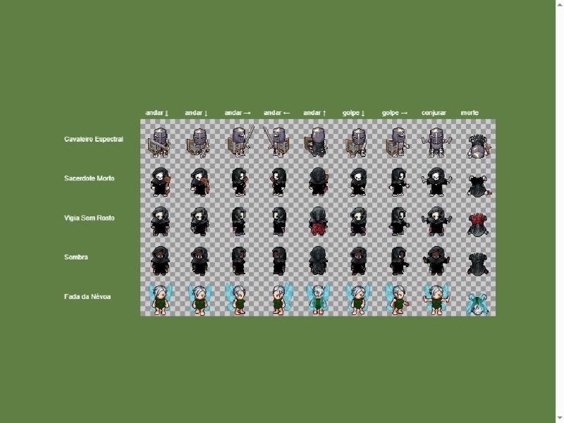
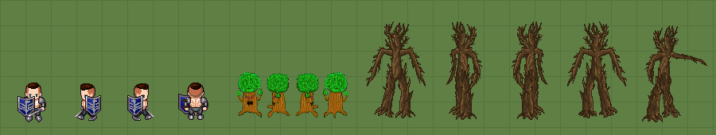

# Monstros da fase 3 com arte LPC (T-056)

Situação em 2026-11-05: **montagem proposta, aguardando o designer.** Ainda não há folhas exportadas no jogo.

## Amostra do gerador

A prancha mostra quadros da folha de cada montagem: andar nas 4 direções, golpe, conjurar e morte. O golpe aparece sem a espada porque a linha padrão do gerador sai sem as armas grandes; no jogo usamos a linha `slash_128`, como no Guarda Esquelético (T-053). O efeito de fantasma ou de sombra ainda não está aplicado: ele entra no Godot, pelo `tint` (ver abaixo).

## Montagens no gerador

Cada link abre o [gerador Universal LPC](https://liberatedpixelcup.github.io/Universal-LPC-Spritesheet-Character-Generator/) já montado. Exporte com **Spritesheet (PNG)** e **Credits (CSV)**, do mesmo jeito que as classes da T-053, e salve com o nome da coluna "Arquivo" em `client/assets/art/characters/`.

| Monstro | Arquivo | Montagem | Link |
|---|---|---|---|
| Cavaleiro Espectral | `spectral_knight.png` | esqueleto, armadura de placas de aço, elmo fechado (*greathelm*), espada longa, escudo *kite* cinza, capa rasgada preta | [abrir](https://liberatedpixelcup.github.io/Universal-LPC-Spritesheet-Character-Generator/#sex=male&body=Skeleton_white&head=Skeleton_white&armour=Plate_steel&hat=Greathelm_steel&weapon=Longsword_longsword&shield=Kite_kite%20gray%20gray&cape=Tattered_black) |
| Sacerdote Morto | `dead_priest.png` | esqueleto (corpo feminino, o único com manto), manto preto, capuz preto, cajado simples | [abrir](https://liberatedpixelcup.github.io/Universal-LPC-Spritesheet-Character-Generator/#sex=female&body=Skeleton_white&head=Skeleton_white&clothes=Robe_black&hat=Hood_black&weapon=Simple_staff_simple) |
| Vigia Sem Rosto (chefe) | `faceless_watcher.png` | esqueleto cinza, manto cinza-escuro, capuz carvão, máscara lisa branca (o "rosto vazio"), capa rasgada vinho | [abrir](https://liberatedpixelcup.github.io/Universal-LPC-Spritesheet-Character-Generator/#sex=female&body=Skeleton_gray&head=Skeleton_gray&clothes=Robe_dark%20gray&hat=Hood_charcoal&facial_mask=Plain_Mask_white&cape=Tattered_maroon) |
| Sombra | `shade.png` | corpo preto, manto e capuz pretos, capa rasgada preta | [abrir](https://liberatedpixelcup.github.io/Universal-LPC-Spritesheet-Character-Generator/#sex=female&body=Body_Color_black&head=Human_Female_black&clothes=Robe_black&hat=Hood_black&cape=Tattered_black) |
| Fada da Névoa | `mist_fairy.png` | corpo feminino claro, cabeça pequena, túnica verde-floresta, cabelo curto branco, asas de fada transparentes | [abrir](https://liberatedpixelcup.github.io/Universal-LPC-Spritesheet-Character-Generator/#sex=female&body=Body_Color_light&head=Human_Female_Small_light&clothes=Tunic_forest&hair=Pixie_white&wings=Transparent_Pixie_Wings_pixie) |

**Escolhas e alternativas testadas:**
- **Fada:** o corpo infantil (menor, mais "fada") perde a roupa no golpe e no conjurar, porque essas peças só existem para o andar. Ficou o corpo adulto com cabeça pequena; o tamanho de fada vem do raio e do `tint`.
- **Sacerdote:** o cajado retorcido some no conjurar; o cajado simples (CC0) aparece no andar, no conjurar e na estocada.
- **Sombra:** com o manto, ela fica parecida com o Sacerdote na folha. No jogo, o `tint` escuro e semitransparente a separa. Se o designer preferir, ela pode ser outro corpo (zumbi, por exemplo).
- **Vigia:** a capa vinho e a máscara branca o separam do Sacerdote. Como chefe, ele usa escala ×2, como a Matriarca.

## Efeito de fantasma, névoa e sombra

O `sprites.json` aceita agora `"tint": [r, g, b]` ou `[r, g, b, a]` (0 a 1), multiplicado sobre o sprite. O campo vale para qualquer sprite e não depende do id. Valores iniciais, a ajustar no teste:

| Monstro | `tint` | Efeito |
|---|---|---|
| Cavaleiro Espectral | `[0.7, 0.85, 1.2, 0.75]` | azulado e semitransparente |
| Fada da Névoa | `[0.9, 1.0, 1.1, 0.8]` | levemente clara e translúcida |
| Sombra | `[0.35, 0.3, 0.45, 0.65]` | escura e translúcida |
| Sacerdote Morto, Vigia | — | sem efeito |

## Ent Corrompido

O gerador não tem corpo de árvore. Dois pacotes no OpenGameArt têm um ent com 4 direções:

| Pacote | Autor | Licença | Animações | Observação |
|---|---|---|---|---|
| [Treant Monster](https://opengameart.org/content/treant-monster) | Tuomo Untinen (Reemax) | CC-BY 3.0 | andar, atacar, morrer; 4 direções | ~32×60 px, feito para tiles de 32. Andar de 3 quadros (padrão RPG), mais simples que o LPC |
| [ents](https://opengameart.org/content/ents) | Matthew Ashworth (macmanmatty) | CC-BY 4.0 | andar e arremessar; 4 direções | o ent de árvore não tem morte (só o de planta); a morte pode ser um esmaecer no Godot |

Baixados com a autorização do designer (2026-11-05) para `..\mmg-art-src\ent-candidates\` (`treant.png`, `tree_ent.png`, `tree_ent_throwing.png`). Ainda não entraram no cliente.

Da esquerda para a direita: o Guerreiro LPC nas 4 direções, o Treant nas 4 direções e o Tree Ent nas 4 direções mais um quadro do arremesso. Escala 1×, com a grade de 32 px.

**Treant (Tuomo Untinen):**
- folha 288×256, com quadros de 32×64: andar (colunas 0 a 2), morrer (3 a 5) e atacar (6 a 8); linhas baixo, esquerda, direita e cima;
- do tamanho de um personagem (~2 tiles de altura);
- traço de desenho animado, com copa verde-viva e contorno grosso. **Destoa do LPC** e não parece "corrompido".

**Tree Ent (Matthew Ashworth):**
- `tree_ent.png`, 240×512, com quadros de 80×128: andar com 3 quadros; linhas baixo, esquerda, direita e cima;
- `tree_ent_throwing.png`, 288×512, com quadros de 96×128: arremesso/golpe com 3 quadros, que serve de ataque;
- árvore seca e retorcida, com sombreamento próximo do LPC. **Combina com "corrompido"**;
- grande: ~4 tiles de altura, o dobro de um personagem. Serve para um monstro de elite, com raio de ~0,7 a 0,9;
- **não tem morte.** Proposta: no Godot, esmaecer e afundar o último quadro, ou recolorir o quadro parado para cinza e tombar.

**Recomendação:** o Tree Ent, se o design da fase 3 aceitar um Ent grande. Os dois têm andar de 3 quadros, mais curto que o do LPC (8 a 9), então o teste em movimento no jogo decide.

## Teste no jogo

Depois da exportação, a variante `preview_fase3` do `sprites.json` troca monstros atuais pelos novos para ver no jogo, com `--art=preview_fase3`:

| Monstro atual | Vira |
|---|---|
| Salteador da Estrada | Cavaleiro Espectral |
| Guarda Esquelético | Sacerdote Morto |
| Lobo Cinzento | Fada da Névoa |
| Rato de Campo | Sombra |
| Matriarca da Floresta | Vigia Sem Rosto (×2) |

## Licenças

Todas as peças das montagens acima têm OGA-BY, CC-BY ou CC0 como opção, exceto o **cabelo da Fada** (*Pixie*: CC-BY-SA 3.0 ou GPL). A folha montada com ele fica em CC-BY-SA, o que não afeta o resto do jogo (`design/art-direction-v0.1.md`, licenças). Se o designer preferir evitar, a Fada pode ficar com o capuz ou outro cabelo OGA-BY. Os créditos completos de cada folha saem no CSV do gerador.

## Pendências

- **Designer:** aprovar ou ajustar as montagens, exportar as 5 folhas e os CSVs, e autorizar o download dos dois pacotes de ent.
- **Agente:** depois da exportação, ligar no `sprites.json` (ids provisórios e variante `preview_fase3`), medir pivôs, testar no jogo e gravar os GIFs.
