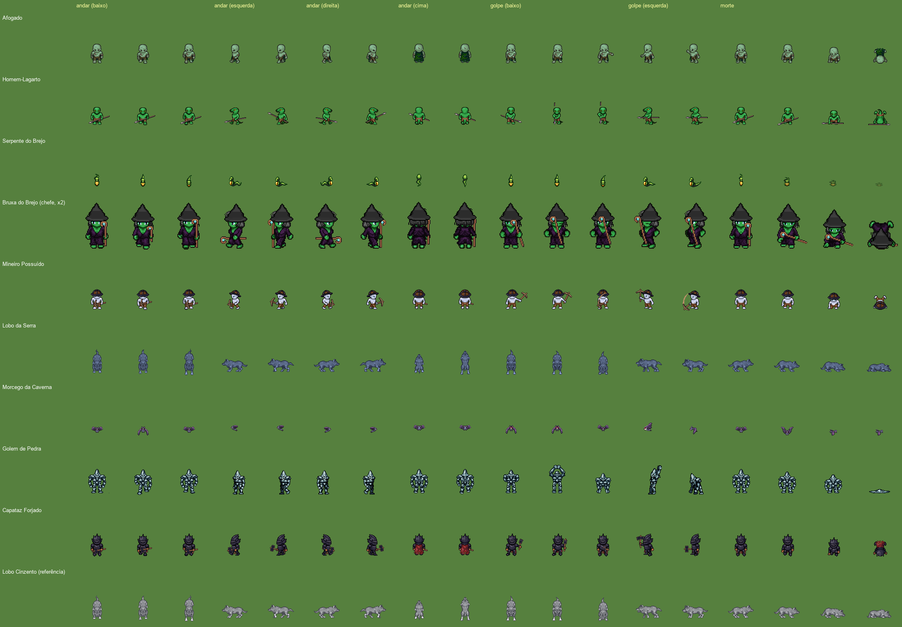
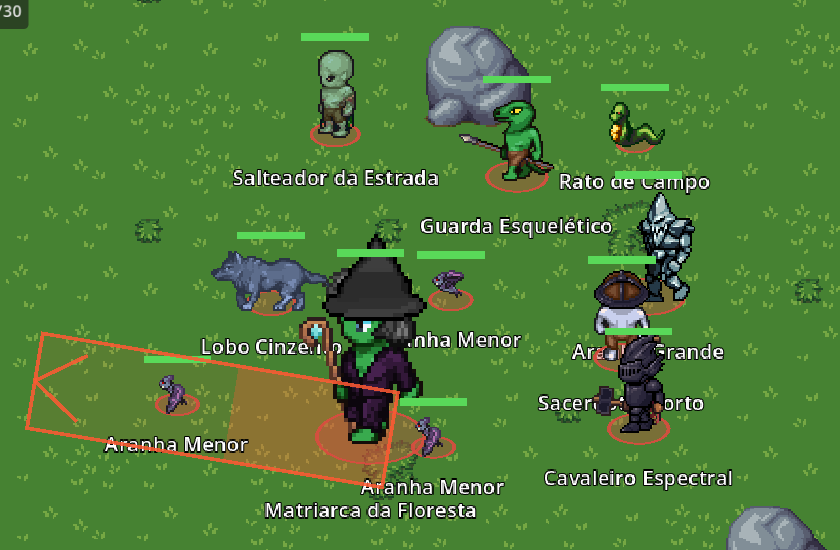
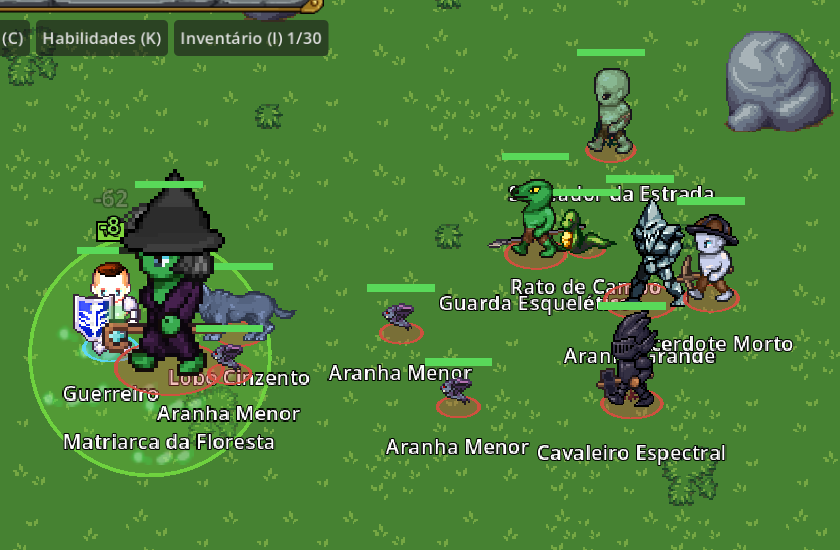

# Monstros da fase 5 (sul, 16 ao 27) com arte LPC (T-521)

Situação em 2026-11-24: **aguardando a aprovação do designer.** As nove folhas estão montadas, ligadas no `sprites.json` e vistas dentro do jogo. Nada foi feito com o PixelLab (reprovado para personagens animados na T-090). Tudo pode ser refeito: o designer pede a troca e a folha é exportada de novo por cima, com o mesmo nome.

## Amostra



**Em movimento (GIF): [amostra-fase5.gif](arte-monstros-fase-5/amostra-fase5.gif).** Cada monstro anda nas 4 direções, golpeia em duas e morre, lido do `sprites.json` do mesmo jeito que o cliente (escala e `tint` incluídos). O Lobo Cinzento aparece no fim como referência para o Lobo da Serra. A prancha e o GIF são gerados por `arte-monstros-fase-5/board.py`.

**Dentro do jogo** (`--art=preview_fase5`, o Guerreiro à esquerda; os rótulos são os dos monstros atuais que a variante troca):

| Captura | Mostra |
|---|---|
|  | Afogado (no lugar do Salteador), Homem-Lagarto, Serpente, Lobo da Serra, Morcegos, Golem, Mineiro, Capataz e a Bruxa em ×2 |
|  | os mesmos já em combate, indo para cima do Guerreiro |

Essas capturas usaram um encontro temporário com os nove monstros juntos, só na cópia local de `client/data/` (não está no Git). Para ver cada um no jogo com os encontros que já existem:

```powershell
Godot_v4.7.2-stable_mono_win64.exe --path client res://scenes/Main.tscn -- --encounter=encounter.wolf_and_bandit --art=preview_fase5
```

| Encontro | Vira |
|---|---|
| `encounter.wolf_and_bandit` | Afogado + Lobo da Serra |
| `encounter.skeleton_guard` | Homem-Lagarto |
| `encounter.four_rats` | quatro Serpentes do Brejo |
| `encounter.forest_matriarch` | Bruxa do Brejo (×2) |
| `encounter.dead_courtyard` | três Homens-Lagarto + Mineiro Possuído |
| `encounter.spectral_knight` | Capataz Forjado |
| `encounter.corrupted_ent` | Golem de Pedra |
| `encounter.mist_ambush` | três Morcegos (+ a Fada) |

## Montagens no gerador (5 monstros)

Cada link abre o [gerador Universal LPC](https://liberatedpixelcup.github.io/Universal-LPC-Spritesheet-Character-Generator/) já montado. Exportado com **Spritesheet (PNG)** e **Credits (CSV)**, como na T-056; as folhas estão em `client/assets/art/characters/` e os créditos em `<monstro>-credits.txt`.

| Monstro | Arquivo | Montagem | Link |
|---|---|---|---|
| Afogado | `drowned.png` | corpo e cabeça de zumbi, calção marrom, capa rasgada verde-musgo (as algas). No jogo: `tint` `[0.62, 0.9, 0.85]` (verde-azulado, a pele encharcada) | [abrir](https://liberatedpixelcup.github.io/Universal-LPC-Spritesheet-Character-Generator/#sex=male&body=Zombie_zombie&head=Zombie_zombie&legs=Shorts_brown&cape=Tattered_forest) |
| Homem-Lagarto | `marsh_lizardman.png` | corpo verde, cabeça e cauda de lagarto, calção marrom, lança de ferro (golpe: estocada, `thrust`) | [abrir](https://liberatedpixelcup.github.io/Universal-LPC-Spritesheet-Character-Generator/#sex=male&body=Body_Color_green&head=Lizard_male_green&legs=Shorts_brown&weapon=Spear_iron&tail=Lizard_tail) |
| Bruxa do Brejo (chefe) | `marsh_witch.png` | pele verde, cabelo cinza desgrenhado (*long messy*), manto roxo, chapéu de mago preto, cajado simples. No jogo: `scale` 2, como o Vigia | [abrir](https://liberatedpixelcup.github.io/Universal-LPC-Spritesheet-Character-Generator/#sex=female&body=Body_Color_green&head=Human_Female_green&hair=Long_messy_gray&clothes=Robe_purple&hat=Wizard_Hat_Base_base_black&weapon=Simple_staff_simple) |
| Mineiro Possuído | `possessed_miner.png` | pele lavanda (pálida, o "tom alterado"), calça marrom, elmo *kettle* de ferro, picareta (golpe: `slash_128`) | [abrir](https://liberatedpixelcup.github.io/Universal-LPC-Spritesheet-Character-Generator/#sex=male&body=Body_Color_lavender&head=Human_Male_lavender&legs=Pants_brown&hat=Kettle_helm_iron&weapon=Pickaxe_ceramic) |
| Capataz Forjado | `forged_overseer.png` | armadura de placas de ferro escuro completa, elmo com chifres, capa rasgada vinho, martelo de ferro (golpe: `slash_128`). **Troca de criatura, ver abaixo** | [abrir](https://liberatedpixelcup.github.io/Universal-LPC-Spritesheet-Character-Generator/#sex=male&body=Body_Color_bronze&head=Human_Male_bronze&armour=Plate_iron&arms=Armour_iron&legs=Armour_iron&shoes=Armour_iron&hat=Horned_helmet_iron&cape=Tattered_maroon&weapon=Hammer_iron) |

**Lobo da Serra (`monster.mountain_wolf`):** não tem folha nova. Usa o sprite do Lobo Cinzento (`monsters/grey_wolf/wolf_light_gray.png`) com `tint` `[0.62, 0.72, 0.9]` (cinza-azulado, "pelo de neve e rocha"). **O designer precisa aprovar esse tom.** Na prancha, a última linha é o Lobo Cinzento original, para comparar.

**Observações do gerador:**
- Logo depois de trocar peças, o gerador às vezes exporta a folha toda transparente (já visto com a Fada na T-056). Cada exportação esperou a prévia carregar e cada folha foi conferida (nenhuma está vazia).
- As camisas testadas (túnica, regata) não apareceram na folha do Mineiro, mesmo selecionadas; ele ficou sem camisa, com a pele lavanda à mostra. Se o designer quiser camisa, é refazer a montagem com outra peça.
- No Capataz, com corpo musculoso a armadura de peito e pernas não aparece (só os ombros); por isso a montagem usa o corpo normal.

## Os quatro que o gerador não monta

Procurados em pacotes de licença livre do OpenGameArt, cada download em pasta própria, com a licença conferida na página:

| Monstro | Arquivo | Pacote | Autor | Licença | Direções e animações |
|---|---|---|---|---|---|
| Golem de Pedra | `monsters/stone_golem/stone_golem.png` | [[LPC] Golem](https://opengameart.org/content/lpc-golem) | Stephen Challener (Redshrike); William.Thompsonj | CC-BY 3.0 (também CC-BY 4.0) | 4 direções; andar de 7 quadros, golpe de 7 (braços para cima e pancada no chão), morte de 7 (desmorona em pedras). 64 px de largura, ~60 de altura. As três folhas do pacote foram empilhadas numa só |
| Morcego da Caverna | `monsters/cave_bat/cave_bat.png` | [[LPC] Bat combined/extended](https://opengameart.org/content/lpc-bat-combinedextended) | bagzie (original), bluecarrot16 (ataque) | OGA-BY 3.0 | 4 direções no voo (4 quadros) e no ataque (3); morte de 4 quadros **só de frente** (usada nas 4 direções). Quadros de 32 px |
| Serpente do Brejo | `monsters/marsh_serpent/marsh_serpent.png` | cobra (`snake.png`) das [LPC Base Assets](https://opengameart.org/content/liberated-pixel-cup-lpc-base-assets-sprites-map-tiles) | Charles Sanchez (CharlesGabriel) | CC-BY-SA 3.0 (também GPL 3.0) | 4 direções, **só andar** (3 quadros); o golpe repete o andar mais rápido; a **morte (4 quadros) foi feita por nós**, achatando e esmaecendo o quadro de frente. Quadros de 32 px |
| Capataz Forjado | `characters/forged_overseer.png` | gerador LPC (acima) | vários | por peça | **troca de criatura**, ver abaixo |

O script `arte-monstros-fase-5/build_sheets.py` refaz as três folhas a partir dos downloads. Licenças e autores completos em `CREDITS.md` e em `client/assets/art/monsters/<monstro>/CREDITS.txt`.

**Pacotes vistos e descartados:**
- *Animated Snake* (Calciumtrice, CC-BY 3.0): uma direção só e traço diferente do LPC.
- *Golem animations* (irmirx): traço de desenho animado e sem andar.
- Os outros golens do OpenGameArt são 3D, só andar, ou de traço que destoa do LPC (o mesmo motivo da reprovação do Ent, T-056).
- Nenhum pacote livre de capataz ou ferreiro monstruoso no estilo LPC; por isso a troca abaixo.

## Troca de criatura proposta: Capataz Forjado

O `monster.forged_overseer` é um chefe de elite das Minas Fundas, ligado à forja. Em vez de procurar uma criatura nova, ele vira um **humano em armadura de ferro negro, elmo com chifres e martelo**, montado no gerador, que combina com o estilo (as outras criaturas humanoides são todas do gerador). O id e o papel não mudam. Se o designer preferir um monstro de verdade (ogro, anão corrompido), isso vira encomenda no estilo LPC. **Registrar na tarefa de monstro que criar o Capataz (T-512):** o visual é "cavaleiro negro com martelo", sem partes de criatura, então combina com golpes de martelo e pancada.

## Como ficou no `sprites.json`

- Layouts novos: `lpc_snake` (32 px), `lpc_bat` (32 px) e `lpc_golem` (64 px, com ataque em quadros de 64×96 e morte de 64×64, e o pivô dos pés alinhado entre as três animações).
- Entradas para os nove ids fixados nas tarefas T-510, T-511 e T-512 (`monster.drowned`, `marsh_lizardman`, `marsh_serpent`, `marsh_witch` ×2, `possessed_miner`, `mountain_wolf` com `tint`, `cave_bat`, `stone_golem`, `forged_overseer`). Nenhum id mudou.
- Variante `preview_fase5` (mecanismo da T-090/T-056) para ver tudo no jogo com os encontros que existem.
- A T-540 liga os monstros no cliente; o `scale` da Bruxa (2) e o `tint` do Afogado e do Lobo da Serra já estão no arquivo.

## Licenças

Conferido nos CSVs exportados e nas páginas do OpenGameArt. Nenhuma peça só com GPL. As folhas do gerador têm OGA-BY 3.0 ou CC-BY-SA 3.0 nas peças (CC-BY-SA no Afogado, no Homem-Lagarto, na Bruxa e no Capataz, que ficam CC-BY-SA; a Serpente também é CC-BY-SA 3.0). O Golem é CC-BY 3.0 e o Morcego OGA-BY 3.0. Os créditos estão em `CREDITS.md`, em `client/assets/art/characters/<monstro>-credits.txt` e em `client/assets/art/monsters/<monstro>/CREDITS.txt`.

## Pendências

**O designer precisa aprovar (em movimento, na prancha ou no jogo):**
1. o `tint` do **Lobo da Serra**, `[0.62, 0.72, 0.9]`;
2. o **Afogado** (zumbi com capa de algas e `tint` verde-azulado; alternativa: corpo de esqueleto);
3. o **Homem-Lagarto** (verde vivo; dá para escurecer);
4. a **Bruxa do Brejo** (pele verde, manto roxo, ×2);
5. o **Mineiro Possuído** (pele lavanda, sem camisa);
6. a **troca do Capataz Forjado** por um cavaleiro negro com martelo;
7. o **Golem de Pedra**, o **Morcego** e a **Serpente** (pacotes do OpenGameArt; a Serpente tem **morte provisória feita por nós**, e o Morcego e a Serpente são pequenos, ~30 px, perto de um personagem de ~46 px de altura).

**Encomenda:** nenhuma obrigatória. Opcionais, se o designer reprovar: Serpente com golpe e morte próprios; Morcego maior; Capataz como monstro de verdade.

**Para a T-540 (cliente):** conferir em jogo a direção das linhas do Golem e do Morcego (assumi a ordem do LPC: cima, esquerda, baixo, direita; no Golem só a linha de costas foi confirmada pela imagem), o raio e a altura da barra de vida de cada um (`headPx`) e o `scale` da Bruxa.
