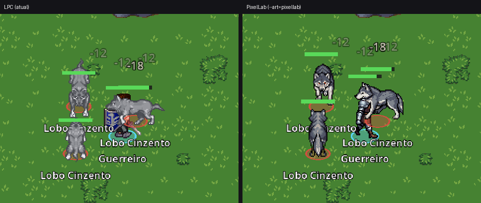
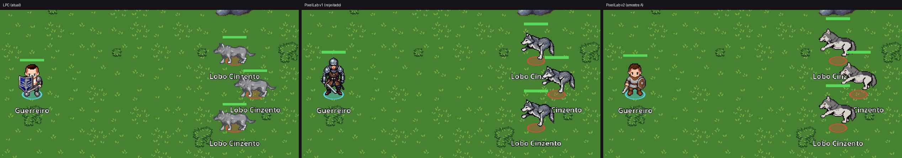
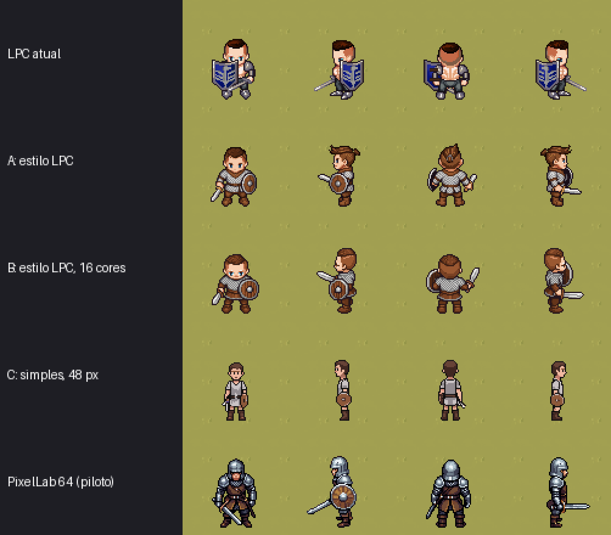
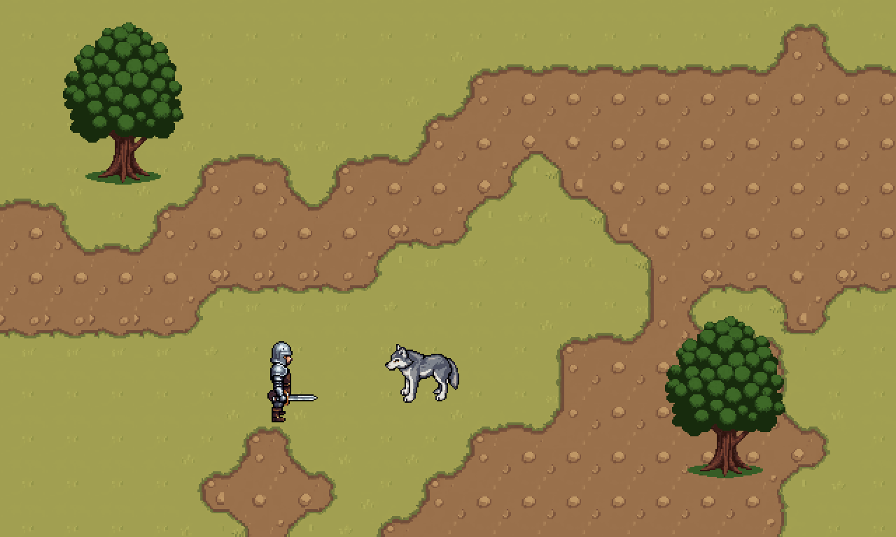

# Piloto PixelLab (T-090)

Data: 2026-11-05. Conta: Tier 1 (2.000 gerações/mês). Ferramenta: MCP do PixelLab no Claude Code.
Arquivos: `client/assets/art/pixellab/` (folhas, tileset, objeto, `manifest.json`, scripts em `tools/`), capturas em `tasks/reports/arte-pixellab-piloto/`.

Para ver no jogo:

```bash
Godot_v4.7.2-stable_mono_win64.exe --path client res://scenes/Main.tscn -- --encounter=encounter.three_wolves --art=pixellab
```

Sem `--art=pixellab` o jogo continua com o LPC, sem nenhuma mudança. Quando uma folha muda de tamanho, rode `Godot --headless --path client --import` antes. Rodar o jogo direto usa a importação antiga em cache, e os quadros saem cortados errado.

## Decisão do designer

**Situação final (2026-11-05): o PixelLab não atingiu a qualidade necessária.** A trilha T-091 em diante **não segue** como está, e o designer vai avaliar outras opções.

O histórico da decisão:
1. Com a v2 no relatório, o designer decidiu "seguir com suas sugestões".
2. Ao ver a v2 no jogo: "o LPC parece ter mais detalhes ao caminhar, ao atacar. O personagem não ficou legal andando", e o Lobo "ao andar fica meio deformado, parece que nada ficou bom".
3. Ele pediu uma última tentativa focada em qualidade de movimento, ataque e tamanho (rodada 3, abaixo). O veredito foi "ainda ruim".

O que segue abaixo mostra como se chegou a isso. O código (`--art=pixellab`, scripts e folhas da v2) fica no repositório, desligado por padrão, como registro do piloto.

### Rodada 3: última tentativa de qualidade (34 gerações, reprovada)

Seguindo a recomendação da base de ajuda do PixelLab (animação por texto v3, uma direção por vez, descrição só do movimento, revisão quadro a quadro), testei de frente e de lado:

| Teste | Resultado |
|---|---|
| Andar do Guerreiro: `skeleton-v3` com 8 quadros e passo maior, v3 por texto (3 descrições), pixminimax | `skeleton-v3` continua rígido; pixminimax **vira o personagem para a câmera** no meio do passo de lado; v3 por texto foi o melhor (pernas alternam, escudo fica), mas uma descrição trouxe "linhas de movimento" desenhadas |
| Golpe do Guerreiro: 5 descrições v3, duas com a pose final fixada na rotação | de frente, um golpe aceitável; de lado, o personagem **gira para a câmera** em todas as tentativas; duas vieram com clarão ou arco amarelo desenhados no sprite, mesmo pedindo "no effects" |
| Lobo novo (56 px, mais baixo e comprido) | proporção melhor que a v2 |
| Andar do Lobo: v3 por texto e o modelo pronto de 8 quadros | v3 sem deformação; o modelo pronto deixa o lobo agachado |
| Mordida do Lobo (v3 com a pose final fixada) | boa de lado, discreta de frente |

Comparação em movimento: `arte-pixellab-piloto/v3-teste-animacoes.gif` (e `andar-teste.gif` para os testes de andar).

**Por que não chega ao LPC:** cada animação é gerada a partir de uma figura parada, e o modelo não mantém pose, lado e equipamento sob controle ao longo dos quadros. O LPC tem animações desenhadas à mão sobre uma base comum: 9 quadros de andar, o golpe com arco de espada em quadro maior, e tudo encaixa entre personagens. No PixelLab, cada animação boa exigiu 2 ou 3 tentativas por direção, e o golpe de lado não saiu bom em nenhuma.

### Antes (rodadas 1 e 2)

O piloto passou por duas versões:
- **v1:** Guerreiro com armadura completa (v3, 64 px). O designer rejeitou: "muitos detalhes, queria algo mais simples".
- **v2 (em uso):** o designer escolheu, entre três amostras, a que usa **o próprio Guerreiro LPC como referência de estilo**. Ela tem contorno escuro grosso, formas simples, poucas cores e cabeça um pouco maior, como o LPC, com o traço mais limpo.

Ajustes propostos na rodada 2 (não seguem mais, ficam como registro):
1. **Estilo:** todo personagem é gerado com `create_character_pro_flash` e uma referência de estilo (`style_image`). A referência é o sprite LPC (para humanoides) ou a rotação de baixo do Guerreiro v2 (para o resto do elenco), e o prompt pede poucas cores e pouco detalhe ("bold black outline, simple flat colours, few details").
2. **Escala:** quadro de 64 px com corpo de ~49 px, ou seja, 1,5 tile, igual ao LPC.
3. **Animações de quem tem equipamento:** modo `skeleton-v3`, que mantém o escudo e a espada. Criaturas sem equipamento continuam com o modelo pronto e o v3 por texto, que são mais baratos.
4. **Tilesets:** modo pro, com vista `low top-down` (T-092).
5. **Antes de animar:** mostrar ao designer uma amostra parada de cada personagem.

## O que foi gerado

### v2 (em uso)

| Asset | Ferramenta | Resultado | Gerações |
|---|---|---|---|
| Guerreiro (8 direções, 64 px) | `create_character_pro_flash` com o sprite LPC como referência de estilo | aprovado pelo designer (amostra A) | 6 |
| Guerreiro: parado, andar, atacar e morrer (4 direções) | `animate_character` em `skeleton-v3`; o ataque usa o golpe `slash` com o escudo à frente | escudo e espada se mantêm em todas as animações; defeitos listados abaixo | 48 |
| Lobo Cinzento (8 direções, 64 px) | `create_character_pro_flash`, modelo `dog`, com o Guerreiro v2 como referência | mesmo traço do Guerreiro | 6 |
| Lobo: parado, andar, atacar e morrer (4 direções) | modelo pronto (parado, andar) e v3 por texto (atacar, morrer) | bons | 16 |
| Tileset grama × terra (32 px, 16 tiles) | `create_topdown_tileset` standard | emendas corretas; grama amarelada e repetição visível | 1 |
| Carvalho (96×128, fundo transparente) | `create_map_object` | bom, casa com o tileset | 1 |

### Testes descartados

| O quê | Gerações | Por quê |
|---|---|---|
| Guerreiro e Lobo v1 com 4 animações cada | 40 | estilo rejeitado |
| Guerreiro em 52 px (v3) | 2 | teste de escala |
| Guerreiro de 52 px animado em `skeleton-v3` | 48 | provou que o `skeleton-v3` mantém o equipamento; estilo rejeitado |
| Amostras B (16 cores) e C (modo standard, pouco detalhe) | 7 | não escolhidas: a C ficou simples demais (corpo fino, escudo pequeno) |

**Total gasto: 209 gerações** (175 nas rodadas 1 e 2 e 34 na rodada 3). Bate com o saldo da conta (1.791 restantes) e com o `manifest.json`, que registra cada chamada com ferramenta, prompt, seed, parâmetros, referência, custo e status.

## Capturas

Nos Campos (`encounter.three_wolves`). A tela cheia escala o jogo em 1,5×.

- `lado-a-lado-inicio.png` e `lado-a-lado-combate.png`: LPC, PixelLab v1 e PixelLab v2 lado a lado.
- `amostras-guerreiro-3x.png`: as amostras A, B e C ao lado do LPC e da v1, ampliadas 3×.
- `escala-1x.png` (e a ampliada 3×), `cena-pixellab-1x.png` e `cena-pixellab-2x.png`: escala em 1× real e cena com tileset e carvalho. Ainda mostram a v1.
- Capturas inteiras: `inicio-*.png` e `combate-*.png`.






## Legibilidade em 1×

- **Guerreiro v2:** cerca de 49 px de altura (1,5 tile), como o LPC. A camisa clara de malha, o escudo de madeira e a espada leem bem sobre a grama. O contorno escuro grosso faz o trabalho que o LPC faz.
- **Lobo v2:** maior que o v1. De lado ele mede 56×54 px, quase da altura do Guerreiro. Lê bem, mas parece um lobo grande. Se o designer quiser um lobo menor, dá para gerar em quadro de 56 px (o mesmo custo).
- Barra de vida, nome e números flutuantes ficam bem posicionados, porque o `headPx` sai da folha.

## Consistência entre o Guerreiro e o Lobo

- O Lobo v2 foi gerado com o Guerreiro v2 como referência. O contorno e o sombreado batem, e o pelo usa a mesma faixa de cinzas da malha do Guerreiro.
- Na v1, as animações por modelo pronto apagavam o escudo do Guerreiro. Na v2, o `skeleton-v3` mantém o escudo e a espada no parado, no andar, no ataque e no morrer.
- **Defeitos na v2:**
  - parado, olhando para a esquerda: a espada sai deformada nos quadros 2 a 4. Hoje o cliente só mostra o quadro 1, que está bom; refazer custa 3 gerações;
  - ataque de baixo e de cima: nos primeiros quadros a espada fica escondida atrás do corpo, então o golpe lê melhor de lado;
  - de costas, o cabelo saiu espetado. Vem da rotação original da amostra A.

## Formato no cliente (`sprites.json`)

- O PixelLab entrega quadros soltos num ZIP (`<estado>/animations/<nome>/<direção>/frame_NNN.png`), e cada animação vem num quadro do tamanho de que precisou: 64 a 96 px no Guerreiro e 64 a 88 px no Lobo. O personagem fica sempre centrado.
- `client/assets/art/pixellab/tools/build_sheet.py` junta tudo numa folha em grade: 4 linhas por animação (cima, esquerda, baixo, direita), quadros centrados numa célula única, sem redimensionar. Ele grava o layout com pivô e `headPx` medidos. O pivô é a média da linha dos pés nas 4 direções; usando só a vista de baixo, o círculo do Lobo de lado ficava 5 px abaixo das patas.
- O cliente já lê esse formato: é o mesmo `grid` do LPC. A única mudança de código foi `variants` no `sprites.json` com `--art=<nome>` no `SpriteCatalog`.
- **Desvio:** a tarefa pede "um layout `pixellab`", mas ficaram dois (`pixellab_warrior` e `pixellab_grey_wolf`). A célula e o número de quadros mudam com o que o PixelLab entrega, e o script gera o layout de cada personagem.
- O papel `idle` do cliente mostra só o primeiro quadro, como no LPC, então a respiração gerada ainda não aparece. Fazê-la tocar é uma mudança pequena no `EntityView` (T-094).
- Não há "conjurar": o Guerreiro usa o ataque. Para as classes mágicas há o golpe `cast` do `skeleton-v3`.

## Tileset no Tiled

- O PixelLab entrega o PNG da folha (4×4 tiles) e um JSON com os cantos de cada tile (NW/NE/SW/SE, `lower`/`upper`) e o retângulo dele na folha. **Ele não entrega `.tsx`**, então o Tiled não abre o tileset direto como wangset.
- A conversão é automática: `tools/tileset_to_tiled.py` gera `data/maps/tilesets/pixellab_grass_dirt.tsx` com um **wangset de canto** (cor 1 = terra, cor 2 = grama). As 16 combinações de canto estão presentes.
- Teste feito:
  1. o próprio Tiled (`tiled --export-tileset`) leu o `.tsx` e reconheceu o wangset `corner` com 16 tiles;
  2. `tools/wang_test_map.py` montou um mapa escolhendo cada tile pelos cantos, como o pincel de terreno faz (`tasks/reports/arte-pixellab-piloto/pixellab_wang_test.tmj`, fora de `data/` para o carregador não tratá-lo como mapa do jogo);
  3. o `tmxrasterizer` do Tiled renderizou esse mapa (`tileset-wang-teste.png`). Todas as emendas casam, inclusive nas diagonais e nas pontas.
- **Falta confirmar à mão:** abrir `tasks/reports/arte-pixellab-piloto/pixellab_wang_test.tmj` no Tiled e pintar com o pincel de terreno. Os dados são os mesmos que o pincel usa, então deve funcionar.
- Qualidade: as emendas estão boas, mas a grama saiu amarelo-oliva e chapada, e as pedrinhas da terra formam uma grade repetida. O modo `standard` custa 1 geração; o `pro` (15 gerações, com textura mais rica, vista `low top-down` igual à dos personagens e paleta controlada) é o candidato para T-092. Terrenos ligados (grama → terra → água) se encadeiam pelo `lower_base_tile_id`. Ainda não testei o tileset com a referência de estilo da v2.
- Fica para a T-092: este tileset tem só 16 tiles, sem variações do tile cheio, por isso a repetição. O tileset LPC atual tem colisões por tile (`ledge`), que o PixelLab não gera; elas seriam desenhadas no Tiled.

## O que funcionou

- **A referência de estilo** (`style_image`) com o sprite LPC deu exatamente o "LPC mais limpo" que o designer queria, com 6 gerações por personagem.
- O **`skeleton-v3`** manteve o equipamento em todas as animações do Guerreiro.
- O Lobo, com o Guerreiro como referência, saiu no mesmo estilo.
- Amostrar só a pose parada antes de animar custa entre 1 e 6 gerações por amostra e evita animar um personagem rejeitado. Animar custa de 16 a 48.
- Fundo transparente nos objetos, tileset Wang convertível para o Tiled e download sem token (o id é a chave).
- Tudo reprodutível pelo `manifest.json` e pelos scripts.

## O que não funcionou ou precisa de cuidado

- **O estilo padrão do PixelLab é detalhado demais para o jogo.** Sem referência de estilo, o v3 desenha armaduras com muito detalhe. Isso custou 90 gerações descartadas (a v1 e o teste de 52 px).
- Animações por modelo pronto redesenham o personagem e perdem o equipamento. Resolvido com `skeleton-v3`, que custa 3 vezes mais.
- O `skeleton-v3` ainda erra às vezes: espada deformada no parado olhando para a esquerda e escondida no golpe de frente. É preciso conferir quadro a quadro e refazer direções isoladas (3 gerações cada).
- `create_character` não aceita seed; o pro-flash aceita. A consistência vem da referência de estilo e do id guardado na conta.
- O Tier 1 tem um limite de 8 tarefas em paralelo, e cada animação de 4 direções ocupa 4. A fila é o gargalo: cerca de 2 a 4 min por lote.
- O tileset standard é pobre e vem na vista `high top-down`.
- Godot: uma folha que muda de tamanho precisa ser reimportada (`--import`).

## Gerações gastas e estimativa para refazer o jogo

Gasto no piloto: **209 gerações**. Dessas, 76 estão nos assets da v2 e 133 foram para testes e amostras. Com a reprovação, a estimativa abaixo fica só como registro. Sobram 1.791 gerações no mês, válidas até 2026-12-05; vale cancelar a assinatura antes da renovação se o PixelLab não for usado para outra coisa.

Estimativa revisada com os custos reais da v2: personagem pro-flash com referência e animações em `skeleton-v3` para quem tem equipamento, com 30% de margem para refazer direções.

| Item | Conta | Gerações |
|---|---|---|
| Amostras de estilo antes de animar | ~25 personagens × 1 a 2 amostras × 6 | ~200 |
| Humanoides: 4 classes, Salteador, Guarda Esquelético, Cavaleiro Espectral e Vigia Sem Rosto (fase 3), uns 6 NPCs | 14 × (6 + 5 animações × 12) × 1,3 | ~1.200 |
| Criaturas: Rato, Lobo (já feito), 2 aranhas, Fadas da Névoa | 4 × (6 + 16) × 1,3 | ~115 |
| Matriarca (128 px, mais cara) | (8 + 4 animações × 4 direções × 2) × 1,3 | ~55 |
| Tilesets de terreno no modo pro | ~15 × 15 | ~225 |
| Prédios e objetos | ~60 objetos × 1 a 2, mais 3 a 5 kits de prédio | ~200 |
| Efeitos e ícones (T-096) | ~100 ícones + ~20 efeitos animados | ~200 |
| **Total estimado** | | **~2.200** |

A estimativa da v1 (~1.500) estava baixa: ela não contava o `skeleton-v3` (3 vezes o custo do modelo pronto) nem as amostras de estilo. Com ~2.200 gerações, há dois caminhos de mesmo custo:
- **dois meses do Tier 1** (US$ 24), com a fila de 8 tarefas;
- **um mês do Tier 2** (US$ 24, 5.000 gerações e 10 tarefas em paralelo). Pelo mesmo preço tem mais folga e fila mais rápida. **Recomendado** quando a trilha começar de fato (T-092 a T-096).
