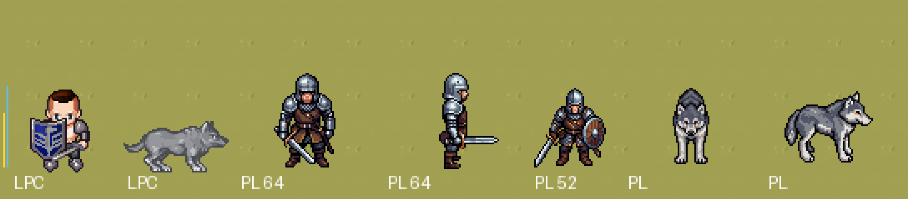

# Piloto PixelLab (T-090)

Data: 2026-11-05. Conta: Tier 1 (2.000 gerações/mês). Ferramenta: MCP do PixelLab no Claude Code.
Arquivos: `client/assets/art/pixellab/` (folhas, tileset, objeto, `manifest.json`, scripts em `tools/`), capturas em `tasks/reports/arte-pixellab-piloto/`.

Para ver no jogo:

```bash
Godot_v4.7.2-stable_mono_win64.exe --path client res://scenes/Main.tscn -- --encounter=encounter.three_wolves --art=pixellab
```

Sem `--art=pixellab` o jogo continua com o LPC, sem nenhuma mudança.

## O que foi gerado

| Asset | Ferramenta | Resultado | Gerações |
|---|---|---|---|
| Guerreiro (8 direções, 64 px) | `create_character` v3 | bom: cota de malha, elmo, espada e escudo legíveis | 2 |
| Guerreiro: parado, andar, morrer (4 direções) | `animate_character` modelo pronto | andar bom; **o escudo some** em parado/andar/morrer (o modelo redesenha o corpo) | 12 |
| Guerreiro: atacar (4 direções) | `animate_character` v3 por texto | golpe legível de baixo e de lado; um quadro de baixo tem um brilho branco | 4 |
| Lobo Cinzento (8 direções, 64 px) | `create_character_pro_flash`, modelo `dog`, referência de estilo = Guerreiro | muito bom, mesmo contorno e sombreado do Guerreiro | 6 |
| Lobo: parado, andar, atacar, morrer (4 direções) | modelo pronto (parado, andar) e v3 por texto (atacar, morrer) | todos bons; morrer por texto saiu de primeira | 16 |
| Tileset grama × terra (32 px, 16 tiles) | `create_topdown_tileset` standard | emendas corretas; grama amarelada e repetição visível | 1 |
| Carvalho (96×128, fundo transparente) | `create_map_object` | bom, casa com o tileset | 1 |
| Guerreiro em 52 px (teste de escala) | `create_character` v3 | 48 px de altura = 1,5 tile, como o LPC | 2 |
| **Total** | | | **44** |

O saldo da conta bate com o `manifest.json`: 44 gerações usadas, 1.956 restantes.

## Capturas

Nos Campos (`encounter.three_wolves`). A tela cheia escala o jogo em 1,5×.

- No início: `arte-pixellab-piloto/lado-a-lado-inicio.png`
- Em combate: `arte-pixellab-piloto/lado-a-lado-combate.png`
- Capturas inteiras: `inicio-lpc.png`, `inicio-pixellab.png`, `combate-lpc.png` e `combate-pixellab.png`
- **Em 1× real**: `escala-1x.png`, mais uma cópia ampliada 3× para ler (`escala-1x-ampliada-3x.png`). A linha amarela marca 1 tile e a azul 1,5 tile.
- Cena só com arte PixelLab: `cena-pixellab-1x.png` e `cena-pixellab-2x.png`, com tileset, carvalho, Guerreiro e Lobo.





## Legibilidade em 1×

- **Guerreiro em 64 px:** fica alto demais. Ele tem 58 px dos pés ao topo (1,8 tile), contra uns 48 px no LPC. Ao lado do Lobo e das pedras ele parece grande. O `size` do v3 controla essa altura: em **52 px** o Guerreiro tem 48 px de altura (1,5 tile). Ele mantém os detalhes e ganha o escudo visível. **Para a trilha: humanoides em `size=52`.**
- **Lobo em 64 px:** o tamanho está certo. De lado ele mede cerca de 54×42 px, comparável ao lobo LPC, e o círculo de colisão de 0,40 fica sob o corpo. A silhueta de frente e de costas é estreita, mas lê bem.
- O contorno preto de 1 px, pedido no prompt, destaca os dois personagens da grama, como no LPC. A frente da armadura em cinza-claro e o pelo do Lobo continuam legíveis.
- Os números flutuantes, o nome e a barra de vida ficam bem posicionados, porque o `headPx` sai da folha.

## Consistência entre o Guerreiro e o Lobo

- A rotação de baixo do Guerreiro serviu de referência de estilo (`style_image`) para o Lobo. Contorno, sombreado com luz de cima e paleta fria e dessaturada saíram iguais. Lado a lado, parecem do mesmo jogo, mais do que os lobos e personagens LPC atuais, que vêm de autores diferentes.
- Problema: as **animações por modelo pronto redesenham o personagem**. No Guerreiro, o escudo some no parado, no andar e no morrer, e a calça muda de tom no ataque de lado. O Lobo não tem esse problema, porque não tem equipamento. Para o T-094, as alternativas são: animar o Guerreiro com `skeleton-v3`, que move o próprio desenho (2 a 4 gerações por direção, mais estável); ou descrever o escudo no prompt da animação v3; ou aceitar o personagem sem escudo.

## Formato no cliente (`sprites.json`)

- O PixelLab entrega quadros soltos num ZIP (`<estado>/animations/<nome>/<direção>/frame_NNN.png`), e cada animação vem num quadro do tamanho de que precisou. No Guerreiro, parado e andar vêm em 64 px e o golpe em 84 px; no Lobo, em 64, 76 e 80. O personagem fica sempre centrado.
- `client/assets/art/pixellab/tools/build_sheet.py` junta tudo numa folha em grade: 4 linhas por animação (cima, esquerda, baixo, direita), quadros centrados numa célula única, sem redimensionar. Ele grava o layout com pivô e `headPx` medidos. O pivô é a média da linha dos pés nas 4 direções. Usando só a vista de baixo, o círculo do Lobo de lado ficava 5 px abaixo das patas.
- O cliente já lê esse formato: é o mesmo `grid` do LPC. A única mudança de código foi `variants` no `sprites.json` com `--art=<nome>` no `SpriteCatalog`.
- **Desvio:** a tarefa pede "um layout `pixellab`", mas ficaram dois (`pixellab_warrior` e `pixellab_grey_wolf`). A célula e o número de quadros mudam com o que o PixelLab entrega, e o script gera o layout de cada personagem.
- O papel `idle` do cliente mostra só o primeiro quadro, como no LPC. A respiração de 4 a 8 quadros que o PixelLab gera ainda não aparece. Fazê-la tocar é uma mudança pequena no `EntityView` (T-094).
- Não há "conjurar": o Guerreiro usa o ataque. Para as classes mágicas há o modelo `fireball` ou o v3 por texto.

## Tileset no Tiled

- O PixelLab entrega o PNG da folha (4×4 tiles) e um JSON com os cantos de cada tile (NW/NE/SW/SE, `lower`/`upper`) e o retângulo dele na folha. **Ele não entrega `.tsx`**, então o Tiled não abre o tileset direto como wangset.
- A conversão é automática: `tools/tileset_to_tiled.py` gera `data/maps/tilesets/pixellab_grass_dirt.tsx` com um **wangset de canto** (cor 1 = terra, cor 2 = grama). As 16 combinações de canto estão presentes.
- Teste feito:
  1. o próprio Tiled (`tiled --export-tileset`) leu o `.tsx` e reconheceu o wangset `corner` com 16 tiles;
  2. `tools/wang_test_map.py` montou um mapa escolhendo cada tile pelos cantos, como o pincel de terreno faz (`tasks/reports/arte-pixellab-piloto/pixellab_wang_test.tmj`, fora de `data/` para o carregador não tratá-lo como mapa do jogo);
  3. o `tmxrasterizer` do Tiled renderizou esse mapa (`tileset-wang-teste.png`). Todas as emendas casam, inclusive nas diagonais e nas pontas.
- **Falta confirmar à mão:** abrir `tasks/reports/arte-pixellab-piloto/pixellab_wang_test.tmj` no Tiled e pintar com o pincel de terreno. Os dados são os mesmos que o pincel usa, então deve funcionar.
- Qualidade: as emendas estão boas, mas a grama saiu amarelo-oliva e chapada, e as pedrinhas da terra formam uma grade repetida. O modo `standard` custa 1 geração; o `pro` (15 gerações, com textura mais rica, vista `low top-down` igual à dos personagens e paleta controlada) é o candidato para T-092. Terrenos ligados (grama → terra → água) se encadeiam pelo `lower_base_tile_id`.
- Fica para a T-092: este tileset tem só 16 tiles, sem variações do tile cheio, por isso a repetição. O tileset LPC atual tem colisões por tile (`ledge`), que o PixelLab não gera; elas seriam desenhadas no Tiled.

## O que funcionou

- Do pedido ao jogo em poucas horas, com 44 gerações (cerca de 2% do mês do Tier 1).
- O estilo é coerente entre os assets quando se passa uma referência (`style_image`).
- Personagem v3 e Lobo pro-flash com qualidade igual ou melhor que a do LPC. A animação de morrer do Lobo, por texto, saiu na primeira tentativa.
- Fundo transparente nos objetos, tileset Wang convertível para o Tiled e download sem token (o id é a chave).
- Tudo reprodutível pelo `manifest.json` e pelos scripts.

## O que não funcionou ou precisa de cuidado

- As animações por modelo pronto redesenham o personagem e perdem equipamento (o escudo).
- `create_character` não aceita seed: refazer gera outro personagem. O que garante a consistência é a referência de estilo e o id do personagem guardado na conta, não a seed.
- O Tier 1 tem um limite de 8 tarefas em paralelo. Cada animação de 4 direções ocupa 4, então a fila é o gargalo (cerca de 2 min por lote), não as gerações.
- O tileset standard é pobre (grama chapada e repetição) e vem na vista `high top-down`; os personagens estão em `low top-down`. O modo pro resolve as duas coisas.
- Tamanho padrão de 64 px: o Guerreiro fica 20% maior que o LPC. Corrigido usando `size=52`.

## Gerações gastas e estimativa para refazer o jogo

Gasto no piloto: **44 gerações**.

Base por personagem, em 4 direções, contando 50% de margem para refazer:

| Item | Conta | Gerações |
|---|---|---|
| Humanoides: 4 classes, Salteador, Guarda Esquelético, Cavaleiro Espectral e Vigia Sem Rosto (fase 3), uns 6 NPCs | 14 × (2 criar + 5 animações × 4 direções + skeleton-v3 onde houver equipamento ≈ 30) × 1,5 | ~630 |
| Criaturas: Rato, Lobo (já feito), 2 aranhas, Fadas da Névoa | 5 × (6 + 16) × 1,5 | ~165 |
| Matriarca (128 px, mais cara) | (8 + 4 animações × 4 direções × 2) × 1,5 | ~110 |
| Tilesets de terreno no modo pro (grama, terra, água, pedra, areia, floresta, 4 estações...) | ~15 × 15 | ~225 |
| Prédios e objetos (casas, muros, cercas, portas, árvores, pedras, móveis) | ~60 objetos × 1 a 2, mais 3 a 5 kits de prédio | ~200 |
| Efeitos e ícones (T-096) | ~100 ícones + ~20 efeitos animados | ~200 |
| **Total estimado** | | **~1.500** |

Cabe em **um mês do Tier 1** (2.000 gerações, US$ 12), com folga para os erros. Se a trilha andar devagar, são 2 meses (US$ 24). O Tier 2 só vale a pena pela fila maior (10 tarefas em paralelo), não pelas gerações.

## Decisão do designer

_(pendente: preencher depois de ver as capturas e rodar `--art=pixellab`)_

- [ ] Seguir com a trilha (T-091 em diante)
- [ ] Ajustar antes de seguir (dizer o quê)
- [ ] Desistir e voltar ao LPC

Recomendação do agente: **seguir**, com estes ajustes já levados para a T-091:
1. humanoides em `size=52`;
2. animações de quem tem equipamento por `skeleton-v3`;
3. tilesets no modo pro com vista `low top-down`;
4. a rotação de baixo do Guerreiro como referência de estilo fixa para todo o elenco.
