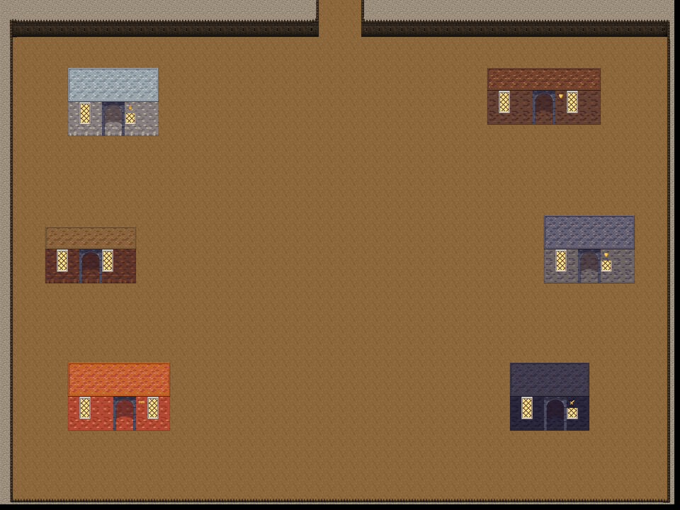
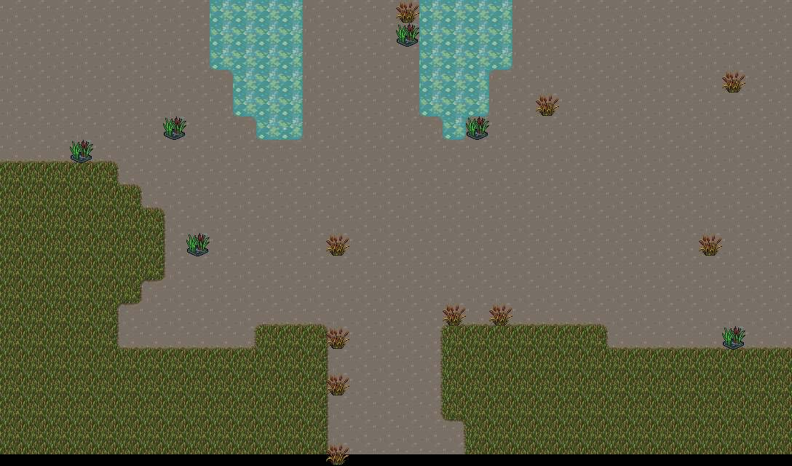

# Forte do Passo (T-531): mapa, zona e portão sul do Brejo

Segundo ponto seguro do jogo (`design/mapas-16-40-v0.1.md` §3.2), no fim do Brejo dos Afogados. Mapa
`data/maps/pass_fort.tmj` (60 × 45), zona `zone.pass_fort` em `data/zones.json` (`safe`, descanso 0,05/s, igual ao da
Cidade). **Aguarda a aprovação do designer no jogo** (e o mapa do Brejo, da T-530, também).



## Como ver no jogo (Windows, raiz do repositório)

Direto no Forte (nasce no pátio):

```powershell
dotnet run --project src/Game.Server -c Release -- --world --dev-login --dev-tools --start-zone zone.pass_fort --port 7777
```

```powershell
Godot_v4.7.2-stable_mono_win64.exe --path client res://scenes/Main.tscn -- --server=127.0.0.1:7777 --name=Designer
```

Pelo caminho de verdade: o mesmo servidor sem `--start-zone`, sair pelo portão sul da Cidade e seguir o aterro do Brejo até
a borda sul (Esc > ferramenta de teste para subir de nível antes).

## O que tem no mapa

- **Muro** de pedra bruta (tileset do forte da T-520, opção C, `pixellab_forte_0`): 2 células com a face escura no norte,
  1 célula nos outros lados (o topo claro de um muro grosso parece pavimento, aviso da T-520). Face e topo bloqueiam.
- **Pátio** de terra batida com seis prédios copiados da Cidade (camadas `props` e `walls_detail`), como as palafitas do
  Brejo. Arte nova nenhuma.

| Prédio (molde da Cidade) | Onde | NPC | Loja |
|---|---|---|---|
| Capela (Templo) | noroeste | Sacerdote (`npc.priest`) | `shop.temple` (poções) |
| Salão dos Mestres (Salão de Treinamento) | nordeste | Mestre das Classes (`npc.class_master`) | — (o cliente da T-541 abre a escolha da segunda classe) |
| Estalagem (Estalagem) | sudoeste | Estalajadeiro (`npc.innkeeper`) | — (decorativo, como na Cidade) |
| Intendência (Ferreiro) | sudeste | Intendente (`npc.quartermaster`) | `shop.pass_fort` (T-513) |
| Quartel Oeste (Armazém), Quartel Leste (Mercado) | oeste e leste | — | — |

- **Portões:** norte aberto (`north_gate`, células 28–31, linhas 0–1) → `zone.drowned_marsh`, chegada `from_fort`.
  Leste (Serra Partida, T-532) e sul (Planalto, fase 6) **fechados**: muro inteiro, como os portões reservados da Cidade.
- **Nascimento** (`spawn`) no meio do pátio (30; 22,5): é onde renasce quem morre na Serra e nas Minas (T-501; a zona
  segura não leva `respawn`, quem aponta para o Forte são as zonas de lá). Chegada do Brejo `from_marsh` em (30; 4,5).

## Portão sul do Brejo



`south_gate` nas células 99–102, linhas 158–159, no fim do aterro de lama (mesmas colunas do portão norte), → `zone.pass_fort`
chegada `from_marsh`. Chegada no Brejo vindo do Forte: `from_fort` em (101; 154,5). Só objetos novos: o terreno e a colisão
do Brejo não mudaram (o aterro já chegava à borda).

## Imagens no jogo (servidor local `--world --dev-login --dev-tools`)

| Arquivo | O que mostra |
|---|---|
| `forte-nascimento.png` | nascimento no pátio: "Forte do Passo · Zona segura", minimapa com os seis prédios |
| `forte-intendente.png` | Intendência e o Intendente ("Intendente · loja") |
| `forte-mestre-das-classes.png` | Salão dos Mestres e o Mestre das Classes |
| `forte-capela.png` | Capela e o Sacerdote |
| `forte-estalagem.png` | Estalagem e o Estalajadeiro |
| `forte-portao-norte.png` | o portão norte, no muro com face |
| `brejo-portao-sul-chegada.png` | saindo pelo portão norte do Forte: chegada no Brejo, no aterro, junto ao portão sul |
| `brejo-portao-sul.png`, `forte-mapa-inteiro.png` | os mapas desenhados por `render_tmj.py` (fora do jogo) |

Os NPCs novos usam folhas provisórias (`client/assets/art/sprites.json`): Intendente com a do Guardião e Mestre das
Classes com a do Arcanista, como os NPCs da Cidade usam as das classes.

## Teste online (Cidade → Brejo → Forte → comprar → voltar)

`tests/Game.NetBots`, servidor local `--world --dev-login --dev-tools`:

```powershell
dotnet run --project tests/Game.NetBots -c Release -- --server 127.0.0.1:7777 --bots 2 --class class.warrior --duration 480 --route zone.pass_fort/npc --shop --shop-id shop.pass_fort --return zone.city/plaza --dev-level --earn 30
```

Resultado: **2 de 2 bots** saíram da Cidade pelo portão sul, caçaram no Brejo até ganhar 31 de ouro (o personagem de
`--dev-login` nasce sem ouro, e as 5 poções iniciais vendem por 5), entraram no Forte pelo portão sul do Brejo,
**compraram uma Poção de Cura Menor com o Intendente** (`shop.pass_fort`) e voltaram Forte → Brejo → praça da Cidade
(`VOLTA ... chegaram 2/2`). Os bots morreram algumas vezes no Brejo e renasceram na Cidade (o Brejo não tem `respawn`).

Opções novas dos bots: `--route` passa por várias zonas (caminho mais curto pelos portões), `--shop-id`, `--shop-item`,
`--return <zona>/<área>`, `--dev-level` (nível máximo pela ferramenta de teste) e `--earn <ouro>`; a linha LOJA agora
mostra o ouro das vendas e o motivo da última recusa.

## Ferramentas

- `tools/build_fort.py`: gera `pass_fort.tmj` do zero e põe o portão sul do Brejo (idempotente no Brejo). Usa
  `../mapa-brejo/tools/tiledjson.py`. O `.tmj` é a fonte daqui em diante, para retocar no Tiled.
- `../mapa-brejo/tools/render_tmj.py` desenha um `.tmj` em PNG.

## Pendências

- **Aprovação do designer** no jogo: do Forte e do Brejo (T-530).
- Pátio grande e liso (só terra batida e prédios); pede retoque se o designer quiser mais detalhe (caixas, barris,
  estandartes: peças que ainda não existem nos tilesets).
- Prédios iguais aos da Cidade (moldes copiados): arte própria do Forte fica para depois, se o designer pedir.
- Câmera e barra de atalhos (da T-530): o portão sul do Brejo fica na última linha, atrás da barra de atalhos.
