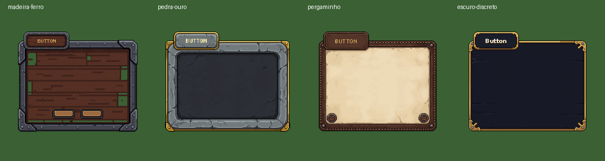
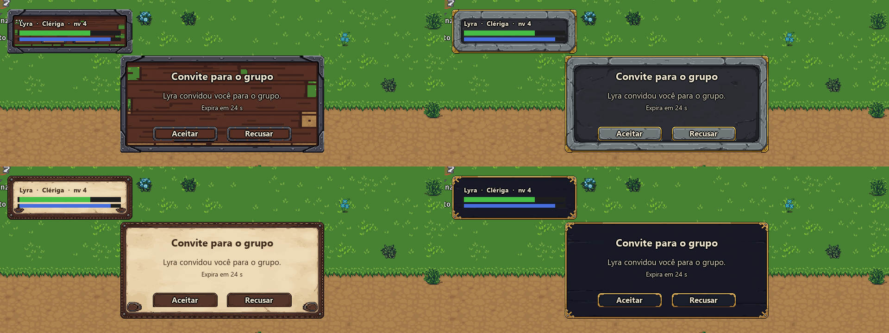
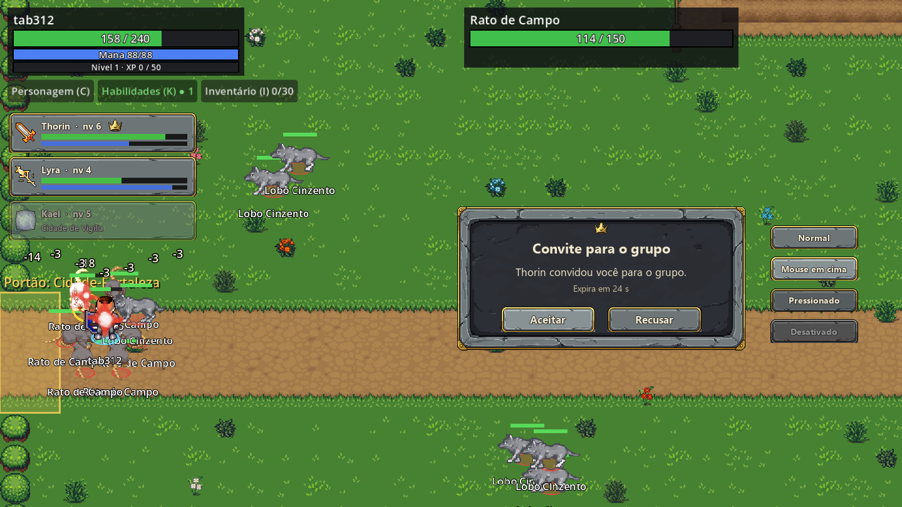

# Kit de interface pedra e ouro (PixelLab)

Situação em 2026-11-06: **aprovado pelo designer.** Fica em `client/assets/art/ui/` para a T-311 (cliente do grupo) usar na janela de convite e no painel do grupo. Se o visual passar no teste do jogo, ele pode virar o tema do HUD todo numa tarefa própria.

## Por que PixelLab

O piloto T-090 reprovou o PixelLab para personagens, porque as animações ficaram abaixo do LPC. Interface é arte parada, sem animação, que era o ponto forte do PixelLab no piloto. O LPC não tem um kit de interface pronto (`design/art-direction-v0.1.md`, lacunas: "tema de interface").

## Escolha do estilo

Foram gerados quatro painéis (`create_ui_asset`, 256×256, 10 gerações cada):

Prévia de cada um como janela de convite e quadro de membro, sobre uma captura do jogo (em cima: madeira e ferro, pedra e ouro; embaixo: pergaminho, escuro discreto):

- **Madeira e ferro:** a geração veio com buracos no painel.
- **Pergaminho:** destoa do HUD escuro e exige texto escuro.
- **Escuro discreto:** o mais próximo do HUD atual.
- **Pedra e ouro:** escolhido pelo designer.

## O kit

| Arquivo | O que é | Como usar no Godot |
|---|---|---|
| `panel.png` (220×162) | painel de pedra com cantos dourados, sem a aba "BUTTON" | `StyleBoxTexture` com margens de 22 px |
| `frame_member.png` (81×31) | moldura fina de pedra (a aba do painel, sem texto) | `StyleBoxTexture` com margens de 9 px; quadro de cada membro |
| `button_normal.png`, `button_hover.png`, `button_pressed.png`, `button_disabled.png` | botão em quatro estados (tons derivados do normal; o pressionado desce 1 px) | `StyleBoxTexture` com margens de 9 px nos estados do `Button` |
| `crown.png` (32×32) | coroa do líder (`create_image_pixflux`, 1 geração; as outras duas candidatas ficam em `pixellab-estilos/coroas/`) | ao lado do nome do líder |

O texto é sempre do Godot, por cima das peças. A arte é desenhada em 1× (sem ampliar), como na prévia.

Na prévia, os ícones de classe vêm do pacote da T-080; o Mago não tem ícone próprio e caiu no ícone padrão. A T-311 escolhe os ícones de classe.

## Custo

43 gerações da assinatura (4 painéis e 3 coroas). As peças do kit foram recortadas do painel escolhido, sem gerar de novo.
