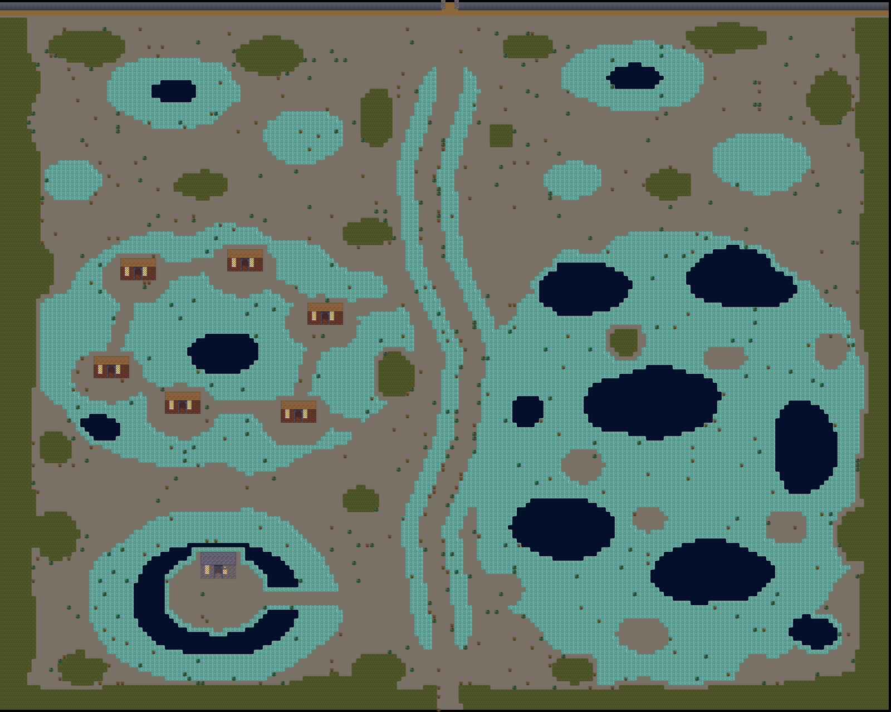
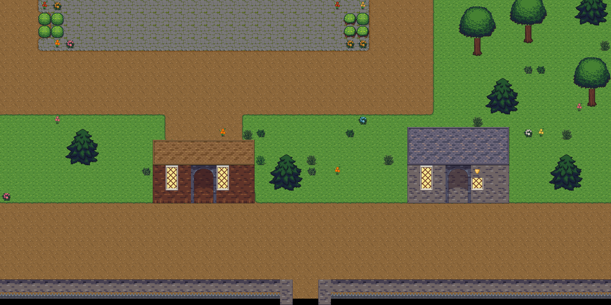

# Brejo dos Afogados (T-530): mapa, zona e portão sul da Cidade

Campo do nível 16 ao 20 (`design/mapas-16-40-v0.1.md` §3.1), saindo pelo portão sul da Cidade. Mapa
`data/maps/drowned_marsh.tmj` (200 × 160), zona `zone.drowned_marsh` em `data/zones.json`. **Aguarda a aprovação do
designer no jogo.**



## Como ver no jogo (Windows, raiz do repositório)

```powershell
dotnet run --project src/Game.Server -c Release -- --world --dev-login --dev-tools --port 7777
```

```powershell
Godot_v4.7.2-stable_mono_win64.exe --path client res://scenes/Main.tscn -- --server=127.0.0.1:7777 --name=Designer
```

Da praça, desça pela rua entre o Armazém e o Mercado até o portão sul (celulas 46–49 da muralha). Use a ferramenta de
teste (`--dev-tools`) para subir ao nível 16–20 antes de lutar.

## O que tem no mapa

| Subárea | Onde | Grupos | Monstros |
|---|---|---|---|
| **Estrada dos Juncos** | faixa norte, do portão até y = 48 | 10 (Afogados nv16 em 2 e 3; grupos mistos Afogado + Homem-lagarto nv17 no fim da estrada) | 24 |
| **Aldeia das Palafitas** | oeste | 11 (bandos de 3 Afogados nv17–18, mistos, pares de Homens-lagarto nv18, Serpentes nv18) | 27 |
| **Charco Fundo** | leste e sul | 15 (pares de Serpentes e de Homens-lagarto nv18–19) | 30 |
| **Cabana da Bruxa** | sudoeste | Bruxa do Brejo (nv20) + 5 bandos de 4 a 6 Afogados nv19 | 25 |

- **42 grupos, 106 monstros**, todos a ≥ 12 tiles uns dos outros. Renascimento de 45 s, como nas Ruínas.
- **Bruxa do Brejo:** chefe de campo nível 20, `announce` true (T-503), renasce em 600 s. Fica na clareira da ilha da
  cabana, cercada por um anel de água funda; o aterro de lama vindo da estrada é o único caminho seco.
- **Estrada dos Juncos:** um aterro de lama de 5 a 6 tiles que vai do portão norte até a borda sul (onde a T-531 abre o
  portão para o Forte do Passo), com água rasa e juncos dos dois lados. Quem só quer passar não pisa em água funda.
- **Água funda:** 2.386 células em 157 retângulos `slow_terrain` com `status.deep_water` e `ignoreTags` `amphibious`
  (T-502): o jogador fica com "Água Funda" (−40% de velocidade); o Homem-lagarto não sente. Fica nos poços do Charco,
  no anel da Cabana, no poço da Aldeia e em dois poços da Estrada. Alguns Homens-lagarto nascem dentro dela.
- **Palafitas:** seis casas abandonadas em ilhas de lama na lagoa rasa, ligadas por passarelas de lama; a cabana da
  Bruxa é a casa de telhado cinza. As casas são cópias de prédios da Cidade (Armazém e Mercado).
- **Borda:** juncal fechado (bloqueia). No norte, a muralha sul da Cidade, com a mesma face e os mesmos pilares do
  portão norte, e uma faixa de terra batida.
- **Quem morre no Brejo volta à Cidade** (a zona não tem `respawn`, T-501).

## Arte

- Tilesets da T-520 (brejo C): `pixellab_brejo_0` (lama → água rasa com vitórias-régias) e `pixellab_brejo_1` (água
  rasa → água funda). Juncos soltos de `pixellab_sul_props` como decoração (não bloqueiam).
- **Novo:** `pixellab_brejo_2`, lama → juncal fechado, para a borda e as moitas que bloqueiam. Gerado no PixelLab
  (tileset Pro, 32 px, *low top-down*, encadeado na mesma lama do `brejo_0`). Custo: 15 gerações (3 do plano + US$
  0,12 em créditos; sobram US$ 0,78). Metadados em `tilesets/`.
- Regra do PixelLab respeitada: a lama nunca encosta na água funda, e o juncal nunca encosta na água (o gerador corrige
  os blocos 2 × 2 sem tile).

## Portão sul da Cidade



- `south_gate` nas células 46–49 da muralha sul (linhas 58–59), entre o Armazém e o Mercado, com os pilares do portão
  norte; chegada `from_marsh` em (48; 55,5). Ficou fora do eixo da avenida porque o Armazém bloqueia a linha reta da
  praça ao muro (a tarefa avisava). Na primeira versão (células 38–41, atrás do Armazém) o bot em linha reta (`--roam`)
  não chegava.
- No Brejo, `north_gate` (células 99–102, linhas 0–1) leva de volta à Cidade; chegada `from_city` em (101; 4,5) e
  nascimento da zona (`spawn`) em (101; 6,5).

## Imagens no jogo

| Arquivo | O que mostra |
|---|---|
| `brejo-portao-norte.png` | chegada pelo portão norte: a muralha da Cidade, o começo do aterro e o juncal |
| `brejo-estrada.png` | o aterro entre a Aldeia e o Charco |
| `brejo-aldeia.png` | palafitas, lagoa rasa e um grupo misto |
| `brejo-charco-agua-funda.png` | Guerreiro dentro de um poço do Charco: "Água Funda" no quadro do personagem |
| `brejo-cabana-bruxa.png` | o aterro da Cabana, o anel de água funda e a Bruxa (barra de chefe) |
| `cidade-portao-sul.png`, `cidade-portao-sul-no-jogo.png` | o portão sul da Cidade |

Os monstros aparecem como círculos: os sprites do sul são da T-521 (ainda não integrada).

## Testes e medidas

- `ZoneMapTests` (Game.Sim.Tests): todo surgimento e portão alcançável a pé; portões batem com as transições; a estrada
  seca liga o portão norte à borda sul sem pisar em `slow_terrain`; água funda com `status.deep_water` e `amphibious`;
  grupos a ≥ 12 tiles, parte deles com 4 a 6 monstros; Bruxa nível 20, anunciada, renasce em 10 min; zona sem
  `respawn`; nenhum bolsão fechado nem fresta sem saída.
- `MarshZoneDesignTests` (Game.Design.Tests, 100 seeds por lote, arena aberta sem água):
  - grupos solo (Estrada, Aldeia, Charco), perfil esperado do nível do grupo, 4 classes: **todos ≥ 99%** (meta 85%);
  - bandos de 4 a 6 Afogados nv19 da Cabana, em dupla (as 5 duplas da T-341): **99–100%**.
- `ZoneGoalDesignTests` (T-505), ligado sozinho com a zona: **16 → 20 em 4,73 h** (95% das 5 h da curva; meta 75%–130%),
  9.967 XP/h, vitória mínima 99%. Por nível: nv16 11.074 XP/h, nv17 9.770, nv18 9.774, nv19 9.593. A Bruxa (grupo de 4):
  1.170 XP por pessoa a cada 10 min, 7.020 XP/h, vitória 100%.
- **Online** (servidor local `--world --dev-login --dev-tools`, `tests/Game.NetBots`):
  - `--route zone.drowned_marsh/deep_water_1`: 2 de 2 bots saíram da Cidade pelo portão sul e chegaram à água funda em
    16–17 s; no nível 1 morreram para os Afogados e **renasceram na Cidade**;
  - `--roam`: Cidade → Brejo → Cidade pelos portões, três vezes em 4 min.
  - "Sentir a água funda" com o personagem foi conferido no cliente (captura do Charco); online, a mesma regra roda no
    servidor (T-502).

## Decisões

- **Bandos de 4 a 6 só na Cabana**, como "grupo recomendado" (como o Pátio das Ruínas). Com 4 Afogados nv17–18 na Aldeia,
  o Guerreiro esperado vencia 41–46% e o Clérigo 0–6%. Na Aldeia os bandos ficaram em 3.
- **Pares de Homens-lagarto nv17 viraram grupos mistos** (Afogado + Homem-lagarto): o Clérigo esperado vencia o par
  nv17 em 81% (meta 85%). Pares nv18 e nv19 ficaram (99–100%).
- A Cabana fica fora do ritmo solo (`MarshZoneDesignTests.SoloHunt`, usado pelo `ZoneGoalDesignTests`).

## Pendências

- **Câmera e barra de atalhos (cliente):** a câmera para na borda do mapa, e o portão sul fica na última linha, atrás
  da barra de atalhos, quando o jogador chega perto dele (ver `cidade-portao-sul-no-jogo.png`). Dá para passar, mas o
  portão quase não aparece. O mesmo vai valer para o portão sul do Brejo (T-531). Sugestão: margem embaixo na câmera.
- **T-531:** abrir o portão sul do Brejo (para `zone.pass_fort`) no fim do aterro, na borda sul (células ~98–103).
- **T-550 (playtest):** os testes de design rodam na arena aberta, sem água. A água funda deve deixar os grupos do
  Charco e da Cabana mais difíceis (o Homem-lagarto é anfíbio).

## Ferramentas

- `tools/build_marsh.py`: gera o `.tmj` do zero (seed fixa) e abre o portão sul da Cidade. Usa `tools/tiledjson.py`,
  que escreve o JSON no mesmo formato dos mapas do repositório (uma linha de mapa por linha). O `.tmj` é a fonte daqui
  em diante, para retocar no Tiled.
- `tools/render_tmj.py`: desenha um `.tmj` em PNG (camadas de tiles, com o deslocamento das camadas do PixelLab).
