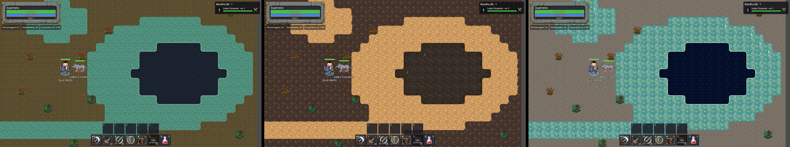
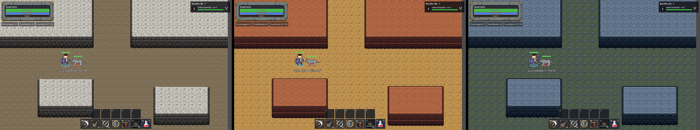
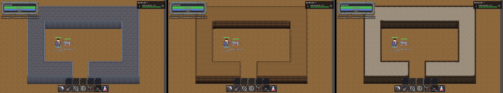

# Tilesets do sul (T-520): 3 opções por bioma, no jogo

Quatro biomas novos (`design/mapas-16-40-v0.1.md` §5), três opções de terreno cada, **todas importadas lado a lado**.
Cada opção está num mapa de amostra pequeno (30×20, não é zona) com o Guerreiro e um Lobo Cinzento em cima, aberto no
jogo de verdade (capturas desta pasta). **O designer escolhe uma opção por bioma.**

Para ver no jogo (Windows, a partir da raiz do repositório; os mapas de amostra existem só no commit `11b4284`, foram removidos depois da escolha):

```powershell
Godot_v4.7.2-stable_mono_win64.exe --path client res://scenes/Main.tscn -- --encounter=encounter.sample_brejo_a --class=class.warrior
```

Troque `brejo_a` por `brejo_b`, `brejo_c`, `serra_a`... `forte_c` (12 amostras). Imagens: `comparacao-<bioma>.png` (as três
opções lado a lado), `<bioma>-<a|b|c>.png` (tamanho cheio) e `folhas-dos-tilesets.png` (as folhas do PixelLab como vieram).

## Como foram feitas

- Mesmo estilo e tamanho dos tilesets de hoje: PixelLab **Pro**, tiles de **32 px**, visão *low top-down*, descrições
  curtas e "simple" no fim, para a arte ficar simples.
- Mesmo traçado de mapa nas três opções de cada bioma; só o tileset muda. A montagem é feita por
  `tools/build_samples.py` (terreno por célula, cada tile centrado no canto entre quatro células, como nas Ruínas;
  paredes com face pelo autotile `pattern_4x4` do PixelLab: o chão logo ao sul de uma parede vira a face dela).
- Colisão dos mapas de serra, mina e forte: bloqueiam o topo da parede **e** a face (a lição do mapa das Ruínas). No brejo
  nada bloqueia (a água funda lenta é da T-502/T-540).
- Os juncos do brejo e os trilhos da mina são sprites de 32 px gerados à parte (1 geração cada) e iguais nas três
  opções: `pixellab_sul_props.png`.

## Brejo (o ponto mais importante: chão × água rasa × água funda)



| | Chão (lama) | Água rasa (andável) | Água funda (andável, lenta) | Leitura |
|---|---|---|---|---|
| **A** | lama marrom-oliva com tufos | verde-azulada clara, marolas brancas | azul-marinho quase preto | **Muito boa.** Três tons bem diferentes; a funda é a que mais salta aos olhos. |
| **B** | turfa marrom escura com musgo | âmbar (cor de chá), parece **areia** | marrom quase preto, parece **terra** | **Ruim.** A água não parece água: lê-se como deserto. Só entra como alternativa. |
| **C** | lama cinza-parda lisa | verde-água coberta de **vitórias-régias** | azul-tinta escuro | **Muito boa e a mais "brejo"**: as vitórias-régias dizem "água rasa" sem precisar de legenda. Chão cinza é um pouco apagado. |

Recomendação: **A** (mais limpa e mais parecida com o resto do jogo) ou **C** (se o designer quiser o brejo com cara
própria). B não.

## Serra (rocha, encosta e penhasco com face virada para o sul)



| | Chão (encosta) | Topo do platô | Face do penhasco | Leitura |
|---|---|---|---|---|
| **A** | cascalho cinza-marrom | granito cinza-claro | cinza-escuro, camadas | Legível, mas **sem cor**: o chão e o platô ficam parecidos em tom. |
| **B** | terra ocre seca | arenito ferrugem | marrom-avermelhado em camadas | **Legível e quente**, destaca bem do verde dos campos. Lembra deserto/mesa. |
| **C** | cascalho cinza-esverdeado com musgo | ardósia azul-acinzentada | azul-escuro quase preto | **Melhor contraste** de platô × face × chão; fria e séria, combina com "Serra Partida". |

Recomendação: **C** (a face escura destaca o penhasco em qualquer luz). B é a escolha se quiser o sul mais quente.

Nota: "encosta" ficou como o próprio chão de cascalho. Uma rampa de verdade (transição de 0,25 com `step_slope`) é mais
uma geração por opção; só vale a pena se o designer quiser.

## Mina (piso de terra, parede de rocha com face, trilhos)


| | Piso | Parede (topo e face) | Leitura |
|---|---|---|---|
| **A** | terra marrom escura | rocha cinza-marrom com veios laranja | **Muito boa.** Parede e piso bem separados; é a "mina de terra". |
| **B** | cascalho carvão | terra escorada por **vigas e tábuas** de madeira | Boa e **mais "mina"** pelas escoras; o piso escuro e o topo marrom ficam próximos (o contorno de madeira salva). |
| **C** | pedra cinza-azulada clara | rocha azul-escura com cristais e ouro | Mais bonita, mas é **caverna de cristal**, não mina de terra; e o piso claro cansa. |

Trilhos: o mesmo sprite nas três (reto, horizontal e vertical). Curvas e cruzamentos não foram feitos; viram peça nova
quando o mapa pedir.

Recomendação: **A** (ou **B**, se o designer preferir as escoras de madeira).

## Forte (chão batido, paliçada e muro de pedra)



| | Parede | Leitura |
|---|---|---|
| **A** | **A muralha da Cidade, sem gerar nada** (`pixellab_city_2`): pedra cinza com ameias | **A mais legível.** Topo cinza e face de tijolo contra a terra batida. Custo zero e já combina com a Cidade. |
| **B** | **Paliçada** de troncos pontudos | A **face** (troncos) lê bem; o **topo** tem a cor da terra, então uma parede grossa parece chão. Funciona só como parede de 1 tile. |
| **C** | Muro de **pedra bruta** com chão de lajes claras e face escura | Legível e diferente da Cidade, mas o topo claro parece pavimento. |

Recomendação: **A** para o muro de pedra (zero custo). Se o designer quiser a paliçada, **B** exige desenhar o Forte
com parede de 1 tile (o mapa de amostra usa 3, que é onde ela mais sofre).

## Custo

Saldo antes: US$ 2,52 em créditos e 6 gerações do plano. Depois: US$ 0,90 e 3 gerações.
- 14 tilesets Pro de 32 px: 6 do brejo (3 opções × lama→rasa e rasa→funda), 3 da serra, 3 da mina, 2 do forte
  (a opção A é a muralha da Cidade, já existente): 15 gerações cada = **210 gerações**.
- 3 sprites de 32 px (2 juncos, 1 trilho): 1 geração cada = **3 gerações**.
- Total: **213 gerações**, pagas com as 3 do plano que restavam e US$ 1,62 em créditos. Nenhuma retentativa. Nenhum
  job falhou (um pedido de água funda foi recusado por um parâmetro e refeito sem custo).
- Sobram US$ 0,90 em créditos (cada tileset Pro custa cerca de US$ 0,12, ou seja, uns 7). As 6 gerações do plano e a
  cota do mês voltam em 2026-12-05.

## A escolha do designer (2026-11-24)

| Bioma | Opção | Tilesets no repositório | ID no PixelLab |
|---|---|---|---|
| Brejo | **C** (vitórias-régias, água funda azul-tinta) | `pixellab_brejo_0` (lama→água rasa), `pixellab_brejo_1` (água rasa→água funda) | `685aac1f-3c48-4c98-b0a3-8452946c5eeb`, `97abf67e-bb54-446d-ac3c-f170f9a4065d` |
| Serra | **B** (ocre e arenito ferrugem) | `pixellab_serra_0` | `614004fa-5264-4a33-bcb0-1486b0ac46ed` |
| Mina | **B** (escoras de madeira) | `pixellab_mina_0` | `2d9c3df3-fda9-4292-bbd0-27c5d3752a1d` |
| Forte | **C** (muro de pedra bruta, lajes claras) | `pixellab_forte_0` | `15aacb71-b31c-484f-b787-5f2c91ad48ac` |

O que ficou de fora: brejo A e B, serra A e C, mina A e C, forte A (muralha da Cidade) e forte B (paliçada). As folhas
saíram do repositório; continuam na conta do PixelLab (ids no fim desta página).

Para quem vai montar os mapas (T-530 a T-533):
- `tilesets/pixellab_*.json` guarda os metadados de cada folha escolhida (cantos, `pattern_4x4`, `bounding_box`), o que o
  autotile precisa. `tools/build_samples.py` mostra como as amostras foram montadas com eles (terreno por célula, tile
  centrado no canto entre quatro células, camada com offset -16; parede com face pelo `pattern_4x4`). O script usa os
  nomes das opções de antes da escolha; para um mapa real, aponte para os nomes definitivos acima.
- Os juncos e o trilho (reto, horizontal e vertical) estão em `pixellab_sul_props` (4 tiles: junco 1, junco 2, trilho
  horizontal, trilho vertical). Curvas e cruzamentos de trilho não existem ainda.
- Pontos de atenção: o forte C tem topo de muro claro, parecido com pavimento, então um muro grosso lê como chão; prefira
  muro de 1 a 2 tiles com face. No brejo, a lama nunca encosta na água funda (não há tile para isso): sempre uma faixa de
  água rasa no meio.

## Limpeza feita depois da escolha

Apaguei as opções não escolhidas (imagens, `.tsx`), os 12 mapas `sample_*` e os 12 encontros `encounter.sample_*` de
`data/encounters.json`. As amostras valem só como as capturas desta pasta (`brejo-c.png`, `serra-b.png`, `mina-b.png` e
`forte-c.png` são as escolhidas). Para ver os mapas de amostra no jogo, use o commit `11b4284`. Ids das folhas do PixelLab
que ficaram de fora, para quem quiser recuperar: brejo A `d31c65f2-37e7-4eb5-8955-1c8a8d75416c` +
`fbddd8b2-da3f-4810-bcc6-dac6a219bdb9`; brejo B `4e27a8fc-cc48-48ec-be19-7c597e72bef8` +
`aa01db05-253b-4537-bdee-5ec63b036bb5`; serra A `bd2121be-7ffd-4986-87ee-dce810d63a59`, C
`afd580d0-24bf-4d25-874a-f75379a3059f`; mina A `6e8cda31-982a-42a9-b86c-5eb4cc56cd33`, C
`db67f422-a629-466c-992d-f668dbe4dff0`; forte B `41f9c764-8639-4117-966c-1db505a67475`; forte A é a muralha da Cidade
(`59673a38-f94b-45b2-8ccf-a360feb2ef2e`).
