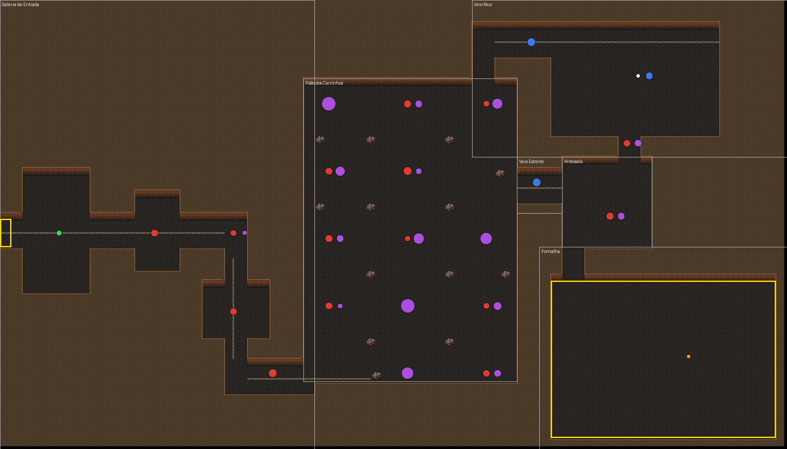

# Minas Fundas (T-533): mapa, instância e portão na Serra

Masmorra instanciada do nível 24 ao 27 para 4 pessoas (`design/mapas-16-40-v0.1.md` §3.4), com o Capataz Forjado (T-512)
na Fornalha. Mapa `data/maps/deep_mines.tmj` (140 × 80), zona `zone.deep_mines` em `data/zones.json` (instância, níveis
24–27, 4 jogadores, os tempos da Cripta, `respawn` `zone.pass_fort`). Entrada pela boca da mina, na Boca das Minas da Serra
Partida. Números: `tasks/reports/balance-v0.28.md`. **Aguarda a aprovação do designer no jogo.**



Na imagem: vermelho = Mineiro Possuído, azul = Lobo da Montanha, roxo = Morcego das Cavernas, branco = Golem de Pedra,
laranja = Capataz (o tamanho do ponto cresce com a quantidade); verde = chegada; amarelo = saída para a Serra e a arena da
Fornalha; retângulos finos = subáreas.

## Como ver no jogo (Windows, raiz do repositório)

Pelo caminho de verdade, saindo do Forte pelo portão leste e indo até a Boca das Minas, no leste da Serra:

```powershell
dotnet run --project src/Game.Server -c Release -- --world --dev-login --dev-tools --start-zone zone.pass_fort --port 7777
```

```powershell
Godot_v4.7.2-stable_mono_win64.exe --path client res://scenes/Main.tscn -- --server=127.0.0.1:7777 --name=Designer
```

Mais curto: `--start-zone zone.broken_ridge` e andar para leste pelo desfiladeiro reto até a boca da mina (o Golem da Serra
fica no caminho). Esc > ferramenta de teste para subir de nível: no nível 1 os monstros das Minas matam em um ou dois golpes.

## O que tem no mapa

| Sala | O que é | Grupos | Monstros |
|---|---|---|---|
| **Galeria de Entrada** | o túnel da saída (borda oeste, com trilho), o salão da entrada e uma galeria em U com dois alargamentos | 4 pequenos (4 a 5), nv24, Mineiros em fila | 18 |
| **Poço dos Carrinhos** | salão de 38 × 53 com carrinhos de minério (bloqueiam: cobertura) | 13 de 6 a 10, nv24 embaixo e nv25 em cima | 112 |
| **Veio Partido: Veio Rico** | sobe do canto norte do Poço, corredor com trilho, a câmara do veio e a descida | 3, nv26: Lobos; o **Golem de Pedra** (elite) + 4 Lobos; Mineiros + Morcegos | 18 |
| **Veio Partido: Veio Estreito** | túnel curto (8 tiles) do Poço direto para a Antessala | 1, nv26: 5 Lobos | 5 |
| **Antessala** | onde as duas rotas se juntam; desce para a Fornalha | 1, nv26: a guarda (Mineiros + Morcegos) | 8 |
| **Fornalha** | arena de **40 × 28** livres, sem obstáculos, área `boss_arena` (`furnace_arena`) | o Capataz Forjado nv27 | 1 |

- **23 grupos, 162 monstros**, todos a ≥ 12 tiles uns dos outros. Instância: nada renasce.
- **As rotas:** o Veio Rico tem mais monstros e o Golem (mais saque); o Veio Estreito é mais curto a pé.
- **A Fornalha não vê a Antessala:** o Capataz puxa a 40 tiles com linha de visão. A descida da Antessala entra pelo canto
  noroeste da arena, e o gerador confere que nenhuma célula fora da Fornalha (e da descida) está na vista dele.
- **Saída:** a borda oeste da Galeria de Entrada (`exit`, 2 × 5) leva à Serra, na chegada `from_mines`, diante da boca da mina.
- **Na Serra:** o portão `mines_gate` fica na boca da mina (células 171–174, linhas 53–54), dentro de `mines_entrance`, que
  ganhou o nome, o nível recomendado e o aviso de grupo, como a entrada da Cripta. A chegada `from_mines` fica em (173,5; 63,5),
  fora dela, a 15 tiles do Golem da Serra (aggro 14).

## Arte

Só o que já existia: tileset da mina escolhido na T-520 (opção B, `pixellab_mina_0`: piso de cascalho escuro, parede de terra
escorada com face de vigas de madeira; topo e face bloqueiam), os trilhos retos de `pixellab_sul_props` e os carrinhos de
minério de `pixellab_serra_props` (T-532). Nenhuma geração nova, nenhum crédito novo. As paredes das galerias são retas (sem os
recortes aleatórios da Serra): são túneis escavados. Os trilhos só têm peças retas, então cada trilho acaba numa junta de
galerias, num carrinho ou numa parede.

## Imagens no jogo (servidor local `--world --dev-login --dev-tools`)

| Arquivo | O que mostra |
|---|---|
| `serra-boca-das-minas.png` | a boca da mina na Serra, com o "Portão: Minas Fundas", o trilho e os carrinhos |
| `minas-entrada.png` | a chegada: "Minas Fundas · Monstros nível 24 a 27", a saída para a Serra à esquerda e o primeiro grupo de Mineiros |
| `minas-galeria.png` | a curva do U da Galeria, com o alargamento e os Mineiros |
| `minas-poco-dos-carrinhos.png` | o meio do Poço: os grupos grandes e os carrinhos |
| `minas-veio-rico-golem.png` | a câmara do Veio Rico, com o Golem de Pedra e a matilha |
| `minas-antessala.png` | a Antessala: a guarda, o túnel do Veio Estreito com os Lobos e a descida do Veio Rico |
| `minas-fornalha.png` | a Fornalha e o Capataz Forjado |
| `minas-mapa-inteiro.png` | o mapa inteiro desenhado fora do jogo, com os grupos |

Os monstros novos aparecem como círculos (os sprites são da T-540/T-521, ainda não integradas). As capturas usam uma cópia
temporária de `data/` (servidor e cliente iguais) em que os monstros têm aggro 1 e a chegada das Minas fica no ponto de cada
vista: o personagem nasce na Serra, anda para a boca da mina e é fotografado na chegada. O mapa do repositório é o mesmo.
A barra do Capataz aparece no alto em toda a instância (o cliente mostra o chefe da zona desde a entrada; ver Pendências da
T-533).

## Online (servidor local `--world --dev-login --dev-tools --start-zone zone.broken_ridge`)

Dois bots em grupo (`tests/Game.NetBots`, `--party --party-size 2 --route zone.deep_mines/furnace_arena --route-again`), numa
cópia de `data/` sem os grupos das salas e da Serra (como a T-350 e a T-352: os bots são nível 1):

- entraram juntos na **mesma cópia** (instância 2) pela boca da mina e chegaram à Fornalha em 69 s;
- morreram para o Capataz, **renasceram no Forte do Passo**, saíram pelo portão leste, voltaram à Serra e entraram de novo na
  **mesma cópia** pela boca da mina: 4 entradas na instância 2 cada um, 3 chegadas à Fornalha em 300 s.

## Ferramentas

- `tools/build_mines.py`: gera `deep_mines.tmj` do zero (determinístico) e chama `../serra-partida/tools/build_ridge.py`, que
  refaz a Serra com o portão das Minas (constantes `MINES_GATE` e `FROM_MINES`). Confere: nenhum bolsão nem fresta sem saída,
  todo ponto alcançável, Fornalha sem obstáculo, grupos a ≥ 12 tiles e a Antessala fora da vista do Capataz. O `.tmj` é a
  fonte daqui em diante, para retocar no Tiled.
- `tools/render_overview.py`: o mapa inteiro com os grupos (`minas-mapa-inteiro.png`).
