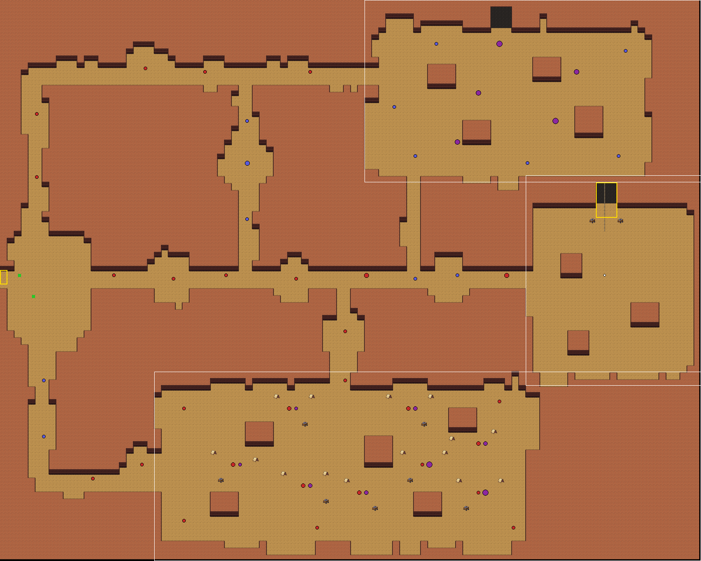

# Serra Partida (T-532): mapa, zona e portão leste do Forte

Campo do nível 21 ao 25 e primeira área de segunda classe (`design/mapas-16-40-v0.1.md` §3.3 e §4), saindo pelo portão
leste do Forte do Passo. Mapa `data/maps/broken_ridge.tmj` (200 × 160), zona `zone.broken_ridge` em `data/zones.json`
(campo, níveis 21–25, `respawn` `zone.pass_fort`). **Aguarda a aprovação do designer no jogo.**



Na imagem: vermelho = Mineiro Possuído, azul = Lobo da Montanha, roxo = Morcego das Cavernas, branco = Golem (o tamanho do
ponto cresce com a quantidade); verde = nascimento e chegada; amarelo = portão oeste e `mines_entrance`; retângulos brancos =
Ninho, Boca das Minas e Acampamento (o resto é Desfiladeiro).

## Como ver no jogo (Windows, raiz do repositório)

Direto na Serra:

```powershell
dotnet run --project src/Game.Server -c Release -- --world --dev-login --dev-tools --start-zone zone.broken_ridge --port 7777
```

```powershell
Godot_v4.7.2-stable_mono_win64.exe --path client res://scenes/Main.tscn -- --server=127.0.0.1:7777 --name=Designer
```

Pelo caminho de verdade: `--start-zone zone.pass_fort` e sair pelo portão leste do Forte (no muro da direita, à altura do
Quartel Leste). Esc > ferramenta de teste para subir de nível antes de lutar: no nível 1 os Mineiros e o Golem matam em
segundos.

## O que tem no mapa

| Subárea | Onde | Grupos | Monstros |
|---|---|---|---|
| **Desfiladeiro** | oeste e centro: o desfiladeiro reto e os anéis norte e sul | 21 (pares de Mineiros nv21, pares de Lobos e de Mineiros nv22; 2 filas de 5 Mineiros nv22 e uma matilha de 5 Lobos nv22) | 51 |
| **Acampamento dos Mineiros** | bacia ao sul, fora da trilha principal | 14 (6 pares de sentinelas nv23; 8 acampamentos de 6 a 10, Mineiros + Morcegos nv22–24) | 76 |
| **Ninho dos Morcegos** | bacia ao norte, com a caverna no penhasco | 11 (6 pares de Lobos nv24; 5 bandos de 6 ou 8 Morcegos nv23–24) | 46 |
| **Boca das Minas** | bacia a leste, no fim do desfiladeiro reto | o Golem de Pedra (elite nv25, renasce em 3 min) e a boca da mina (`mines_entrance`, T-533) | 1 |

- **47 grupos, 174 monstros**, todos a ≥ 12 tiles uns dos outros; **16 grupos (34%) com 5 a 10 monstros**. Renascimento
  45 s nos grupos pequenos (como no Brejo), 60 s nos grandes, 180 s no Golem.
- **Desfiladeiro reto:** 128 tiles em linha, do portão oeste à Boca das Minas, 5 livres entre os penhascos (a linha de
  cima é a face do penhasco norte), com alargamentos e cruzamentos. Os monstros dele vêm em fila. O Golem fica na mesma
  linha, depois do fim: a Rocha Rolante desce o corredor (captura `serra-boca-das-minas.png`).
- **Corredores laterais:** norte-sul com 4 tiles livres, leste-oeste com 5. Anel norte (sobe da entrada, corre para leste e
  desce de volta ao reto), anel sul (desce da entrada e corre até o Acampamento), ligações do reto ao Ninho e ao
  Acampamento.
- **Acampamento:** barracas e carroças de minério (bloqueiam). No máximo 4 Mineiros por acampamento; o resto é Morcego (ver
  Decisões).
- **Caverna e boca da mina:** recortes no penhasco pintados com o piso escuro da mina (`pixellab_mina_0`); um trilho sai da
  boca da mina para a bacia. Só desenho: a boca bloqueia (a T-533 põe o portão das Minas em `mines_entrance`, que inclui as
  4 linhas livres na frente dela).
- **Portões:** `west_gate` (células 0–1, linhas 77–80) → `zone.pass_fort`, chegada `from_ridge`. Chegada do Forte
  `from_fort` em (5,5; 78,5); nascimento da zona `spawn` em (9,5; 84,5).
- **Quem morre na Serra renasce no Forte** (T-501).

## Arte

- Terreno: tileset da serra da T-520 (opção B, `pixellab_serra_0`): encosta ocre, topo do platô em arenito ferrugem, face do
  penhasco para o sul. Platô e face bloqueiam (lição das Ruínas). Autotile pelo `pattern_4x4`, como o Forte.
- O traçado é desenhado em blocos de 2 × 2 células: o tileset não tem degrau de 1 linha na base do penhasco (o tile fica
  preto, como nas Ruínas), e fechar a célula do degrau criava outro degrau ao lado, em cascata. Com blocos de 2, todo degrau
  tem 2 linhas ou mais. As bordas das escavações ganharam recortes (0 ou 2 células; 0, 2 ou 4 nas bacias) para a rocha não
  parecer régua; o desfiladeiro reto ficou liso.
- **Novo:** `pixellab_serra_props` (barraca de lona e carroça de minério, objetos de 64 px do PixelLab, *low top-down*,
  pouco detalhe). Custo: 2 gerações do plano (sobra 1 do plano; créditos intactos, US$ 0,78). Créditos em `CREDITS.md`.

## Imagens no jogo (servidor local `--world --dev-login --dev-tools`)

| Arquivo | O que mostra |
|---|---|
| `serra-portao-oeste.png` | chegada pelo portão oeste: "Serra Partida · Monstros nível 21 a 25", o portão para o Forte e o primeiro par de Mineiros no desfiladeiro reto |
| `serra-desfiladeiro-reto.png` | o desfiladeiro reto com alargamento; Mineiros nv21 vindo em fila |
| `serra-acampamento.png` | barracas, carroças e acampamentos de Mineiros + Morcegos |
| `serra-ninho-dos-morcegos.png` | a caverna no penhasco norte e os bandos de Morcegos |
| `serra-boca-das-minas.png` | a boca da mina com o trilho e a Rocha Rolante do Golem telegrafada pelo corredor |
| `forte-portao-leste.png` | o portão leste aberto no muro do Forte |
| `serra-morte-retornar-ao-forte.png` | morrer na Serra com o cliente da T-541: "Retornar ao Forte do Passo" (cópia temporária desta branch com a T-541 mesclada; a arte do mapa não foi importada nessa cópia, por isso o fundo cinza) |
| `serra-mapa-inteiro.png` | o mapa inteiro desenhado por `render_tmj.py` (fora do jogo), com os grupos |

Os monstros da Serra aparecem como círculos: os sprites são da T-540/T-521 (ainda não integradas). As capturas foram
feitas no nível 1 movendo o nascimento da zona para o ponto de cada vista, numa cópia temporária do `.tmj` (o mapa do
repositório não mudou); em algumas o personagem já está sendo atacado.

## Testes e medidas

- `ZoneMapTests` (Game.Sim.Tests): todo surgimento e portão alcançável a pé (a Serra entrou na lista); portões batem com as
  transições; a Serra sai pelo portão leste do Forte com as 4 subáreas, só os monstros da T-511, níveis 21–25, o Golem como
  única elite (nv25, Boca das Minas, 180 s) e `mines_entrance` alcançável; `respawn` = Forte; grupos a ≥ 12 tiles, de 1 a
  10 monstros, ≥ 1/3 com 5 ou mais e um de 10; desfiladeiro reto (linha livre de ≥ 100 tiles com ≥ 60 colunas de 3 a 5
  livres) com o Golem na linha, depois do fim; nenhum bolsão nem fresta sem saída. O teste do Forte agora pede os portões
  norte e leste abertos e o muro sul e oeste inteiros.
- `RidgeZoneDesignTests` (Game.Design.Tests, 100 seeds, perfil esperado com segunda classe do nível do grupo, os mesmos
  lotes do ritmo):
  - grupos de caça solo (até 4 monstros), as 8 segundas classes: **100%** em todos (meta 85%);
  - grupos grandes (5 a 10), as 6 segundas classes que não são do Clérigo: **87–100%** (meta 85%; o pior é o Caçador
    contra 4 Mineiros + 4 Morcegos nv23, 87%);
  - Sacerdote e Inquisidor contra os grupos grandes, só medidos: 0–100% (perdem para as filas de Mineiros e os
    acampamentos; vencem os bandos de Morcegos). Pedem grupo, como o Acampamento da T-511.
- `ZoneGoalDesignTests` (T-505), ligado sozinho com a zona: **21 → 25 em 5,91 h** (84% das 7 h da curva; meta 75%–130%),
  **12.516 XP/h**, vitória mínima 100%. Por nível: nv21 11.607 XP/h, nv22 11.948, nv23 12.147, nv24 14.394. Só os grupos
  de caça solo (sem os grandes e sem o Golem).
- XP por hora de quem caça **só os grupos grandes** (medida, sem caminhada): Piromante e Arcanista ~62.500, Guardião e
  Berserker ~49.000, Caçador e Atirador ~36.500, Sacerdote e Inquisidor ~12.000.
- **Online** (`tests/Game.NetBots`, servidor local `--world --dev-login --dev-tools --start-zone zone.pass_fort`):
  `--route zone.broken_ridge/mines_entrance` com 2 Guerreiros nível 1: saíram do Forte pelo portão leste, entraram na
  Serra, morreram e **renasceram no Forte** (`zone.broken_ridge → zone.pass_fort (renasceu)`, 16 vezes em 200 s), e
  voltaram pelo portão. Com `--dev-level` (nível 40 sem pontos gastos) também morreram no caminho antes da Boca das Minas;
  o percurso a pé até `mines_entrance` é conferido pelo teste de mapa.

## Decisões

- **Ritmo solo com pares, grupos grandes como bônus de área.** Os monstros dão 6 × nível de XP; com o descanso de 50 s
  por grupo do modelo, um grupo de 4 Mineiros dava ~19.500 XP/h e um bando de 6 Morcegos ~39.000, contra a meta de
  8.130–14.100. Os grupos de caça solo ficaram em pares (≈ 12.500 XP/h); os grupos de 5 a 10 ficam fora do ritmo solo
  (`RidgeZoneDesignTests.SoloHunt`), como a Cabana da Bruxa no Brejo, e rendem de 3 a 5 vezes mais para quem tem dano em
  área. **Pendência para o designer/T-550:** é o que o design pede ("grupos grandes pedem dano em área"), mas a diferença
  é grande.
- **No máximo 4 Mineiros por grupo grande.** Com 5 ou 6 Mineiros nv23–24 no acampamento, o Guardião e o Berserker sozinhos
  venciam 0–47% e o Atirador 50–70% (a Picaretada atordoa). Os acampamentos são 4 Mineiros + 2 a 4 Morcegos, e os de 10
  são 3 Mineiros + 7 Morcegos. As filas de 5 Mineiros nv22 do desfiladeiro passam (96–100%).
- **Sentinelas nv23 no Acampamento e Lobos nv24 no Ninho** dão os grupos de caça solo dos níveis 23 e 24 (a faixa da
  tarefa põe o Acampamento em 22–24 e o Ninho em 23–24).
- **Portão leste do Forte** nas linhas 22–25 da coluna 59 (a linha 21 do vão vira a face do muro e bloqueia, como o resto
  do muro), chegada `from_ridge` em (56,5; 23,5).
- `FieldGroups` ganhou 3 posições na frente (até 10 corpo a corpo, para o acampamento de 10); `ZonePace.SoloBatches`
  expõe os lotes por perfil, para o teste da zona reusar os lotes do ritmo.

## Pendências

- **Aprovação do designer** no jogo (mapa, caverna, boca da mina, barracas e carroças).
- **T-533:** pôr o portão das Minas Fundas dentro de `mines_entrance` (células 170–175, linhas 52–61); hoje a boca é só
  desenho e bloqueia (a linha 52 é face).
- **T-550 (playtest):** os testes rodam na arena aberta; no mapa, as filas no desfiladeiro e a Rocha Rolante no corredor
  podem mudar as lutas. Conferir também o XP por hora dos grupos grandes com dano em área.
- Os bots com `--dev-level` (nível 40 sem pontos) morrem na Serra; um bot que gaste pontos ou escolha segunda classe
  ajudaria a testar o percurso online até a Boca das Minas.
- `design/map-conventions-v0.1.md` §10 (mapas atuais) não lista a Serra (fora das áreas desta tarefa).

## Ferramentas

- `tools/build_ridge.py`: gera `broken_ridge.tmj` do zero (seed fixa) e abre o portão leste do Forte (idempotente). Usa
  `../mapa-brejo/tools/tiledjson.py`. O `.tmj` é a fonte daqui em diante, para retocar no Tiled.
- `../mapa-brejo/tools/render_tmj.py` desenha um `.tmj` em PNG.
